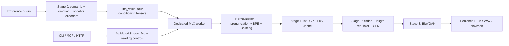

# index-tts-rs

[English](README.md) | [简体中文](README.zh-CN.md)

Local, expressive speech synthesis and zero-shot voice cloning for **Apple Silicon**, powered by **IndexTTS-2.5** and **MLX / Metal**. Use the `itts` CLI, a warm-model daemon, an MCP server, or the browser speech studio and HTTP API.

The inference pipeline, DSP, text frontend, and application code are implemented in Rust. Normal synthesis needs **no Python or PyTorch runtime**; `mlx-rs` binds to Apple's native MLX C/C++ backend, Metal, and Accelerate. This is a platform-specific inference implementation, not a model-training toolkit.

## What you can do

- Clone a voice from a short recording and reuse it as an `.itts_voice` snapshot.
- Read prose, poetry, and dialogue with explicit emotion, temperature, speed, pronunciation, and pause controls.
- Receive completed sentences while later sentences are still being generated: play locally, write WAV, or consume PCM / JSON Lines.
- Share one resident model between CLI and MCP sessions through the daemon.
- Drive the same validated speech-job contract from shell automation, agents, and HTTP.
- Run synthesis locally after downloading weights. Optional DeepSeek annotation sends text to the configured provider; manual controls need no API key.

## Requirements and installation

**Supported target:** macOS on Apple Silicon (`aarch64-apple-darwin`). Intel Macs, Linux, Windows, and CUDA are not supported by this workspace. Language selectors are `zh`, `en`, `zh/en`, `ja`, `yue`, `es`, and `ar`; quality depends on the language, text, and reference voice.

For a source build, install:

- Rust via [rustup](https://rustup.rs/). This checkout pins **Rust 1.99.1**, edition 2024.
- Full Xcode, selected as the active developer directory, including the Metal compiler. Command Line Tools alone may lack it. Check `xcodebuild -version` and `xcrun --find metal`.
- [CMake](https://cmake.org/download/) (`brew install cmake` when using Homebrew). The MLX build fetches native sources, so initial compilation needs network access.
- About **5 GB of disk space for model weights**, plus build artifacts and cache. Historical process peaks were roughly 2.5 GB with a saved voice and 3.94 GB with reference audio; these are measurements, not minimum system-memory guarantees.

```bash
git clone https://github.com/tyrchen/index-tts-rs.git
cd index-tts-rs

# Installs an optimized `itts` into ~/.cargo/bin by default.
cargo install --path apps/cli --locked
itts --version
itts --help

# Optional: install the bundled Codex / Claude / Gemini skill files as well.
make install-skill

# Build both CLI and HTTP server without installing them.
cargo build --release --workspace --locked
```

`make install` combines CLI installation with skill installation. The skill step replaces existing `itts` skill directories under `~/.agents/skills`, `~/.claude/skills`, and `~/.gemini/config/skills`; use `cargo install` alone if you maintain customized copies.

The default README is English; the [Chinese README](README.zh-CN.md) covers the same workflow. Release source packages and publication steps are described in the [release guide](docs/usage/releasing.md).

## Your first voice and speech

Use a clean, single-speaker recording, ideally 3–15 seconds, with permission from the speaker. WAV, MP3, FLAC, and M4A containers are accepted; decoding depends on the contained codec. WAV PCM is the simplest reference format.

```bash
# Download yunfengwang/IndexTTS-2.5-mlx (and the 56 MB 48 kHz extender) into the Hugging Face cache.
itts models pull
itts models info
itts doctor

# Extract the speaker once; later synthesis skips the reference encoders.
itts voice add narrator --ref /path/to/reference.wav
itts voice list
itts voice inspect narrator

itts synth --voice narrator --lang en \
  --text "Hello from Apple Silicon." --out hello.wav

# Playback is optional; --out alone works without an audio output device.
itts synth --voice narrator --text "你好，欢迎使用语音合成。" \
  --out hello-zh.wav --play
```

Choose one speaker source: `--voice ID`, `--voice-file PATH.itts_voice`, or `--ref AUDIO`. Choose at least one output: `--out FILE.wav`, `--out -`, or `--play`.

```bash
# One-off cloning without registering a voice.
itts synth --ref /path/to/reference.wav --lang en \
  --text "A new voice, from a reference recording." --out cloned.wav

# Bash / Zsh: read a script from stdin.
itts synth --voice narrator --stdin --out narration.wav < script.txt

# Exported speaker snapshot, with no registered voice ID needed.
itts synth --voice-file /path/to/narrator.itts_voice \
  --text "Portable speaker conditioning." --lang en --out snapshot.wav
```

WAV output is **22,050 Hz, mono, signed 16-bit PCM** by default. The model's audio stops at 11 kHz; `--sample-rate 48000` keeps that band and synthesizes 10–24 kHz with the [LavaSR v2](https://huggingface.co/YatharthS/LavaSR) bandwidth extender (Apache-2.0, about 35 ms per 8 s of speech; see the [evaluation](docs/research/speech-bandwidth-extension-research.md)). Timings and durations are identical at both rates. `--out -` writes headerless little-endian PCM to stdout and sends the summary to stderr. Text input is capped at **16,384 UTF-8 bytes** per job. Split longer documents into jobs.

## Keep models warm

```bash
itts daemon start             # detaches; returns when ready; do not append &
itts daemon ensure            # start only if needed
itts synth --voice narrator --text "Reuse the loaded model." --lang en --out warm.wav
itts daemon status
itts daemon logs -n 50
itts daemon restart           # use after upgrading the CLI
itts daemon stop
```

`synth` and `voice add` use an existing daemon automatically and otherwise run in-process. `--no-daemon` forces an isolated run. The daemon exits after 600 idle seconds by default; start with `--idle-timeout-secs 0` to keep it resident. Status polling does not reset the idle timer.

Voices default to `~/.cache/index-tts-rs/voices`; weights use the Hugging Face cache. Global `--voices-dir`, `--model-dir`, and `--config` override paths. Start the daemon with the configuration you intend to reuse. The HTTP server owns a separate engine, so running it alongside the daemon adds another model copy.

## Direct emotion and pacing

Controls are stateful and apply to following text until changed or `[[reset]]` restores the initial settings. Blank lines preserve paragraph and stanza boundaries.

```bash
itts synth --voice narrator \
  --text '[[emo=melancholic:0.35,calm:0.35]][[temp=0.72]][[speed=0.88]]轻轻的我走了，[[pause=600]]正如我轻轻的来。' \
  --out poem.wav

# Optional provider-assisted annotation; requires DEEPSEEK_API_KEY.
itts annotate --stdin --poetry < poem.txt > poem.itts.txt
itts synth --voice narrator --stdin --out poem.wav < poem.itts.txt
```

| Control | Meaning |
| --- | --- |
| `[[emo=happy:0.3,calm:0.2]]` | Mix speaker-matched emotion prototypes; `[[emo=none]]` restores base emotion |
| `[[temp=0.72]]` | GPT sampling temperature, `0.05..=2.0`; affects variation, not a direct pitch control |
| `[[speed=0.9]]` | Speaking-rate multiplier relative to `--speed` (default 1.2), `0.25..=4.0`; larger is faster |
| `[[pause=600]]` | Insert 600 ms of digital silence; range `0..=5000` ms |
| `[[voice=other_voice]]` | Switch to another registered speaker |
| `[[lang=en]]` | Switch language |
| `[[reset]]` | Restore initial speaker and speech controls |

`--continuity` makes each sentence continue after the previous one instead of starting afresh, and `--previous-text` does the same across separate requests (for line-by-line scripts). `itts annotate --units` returns one emotion/speed/temperature/pause delivery per line ID. Both are described in the [speech-control guide](docs/usage/itts-speech-controls.md).
| `<行\|hang2>` | Pronunciation override; also supports English ARPAbet |

Eight emotion categories accept English and Chinese names: `happy` / 高兴, `angry` / 愤怒, `sad` / 悲伤, `afraid` / 恐惧, `disgusted` / 反感, `melancholic` / 低落, `surprised` / 惊讶, and `calm` / 平静. Emotion strengths are conditioned model inputs, not calibrated perceptual scores.

YAML settings live in [config/default.yaml](config/default.yaml) and [config/director.yaml](config/director.yaml). For example, set `default_voice: narrator` to omit `--voice`, then run `itts --config /path/to/settings.yaml synth ...`. See the [speech-control guide](docs/usage/itts-speech-controls.md) for mixing rules, provider configuration, and annotation limits.

## Agents, JSON, and MCP

```bash
itts doctor --output json
itts synth --voice narrator --text "你好。" --out hi.wav --output json
itts synth --voice narrator --text "第一句。第二句。" --out stream.wav --output jsonl
itts synth --voice narrator --text "第一句。第二句。" --out timed.wav --timestamps --output json
itts schema controls
itts schema speech-job
itts schema events
```

Use `--output text|json|jsonl` or `ITTS_OUTPUT`. JSON synthesis returns fields such as `status`, `backend`, `durationSecs`, `synthesisSecs`, `rtf`, `outputPath`, and the `seed` that reproduces the take. JSONL streams `started` → `chunk` → `done` events; each chunk names the text it reads. `--timestamps` adds per-character `alignment` (ElevenLabs `with-timestamps` shape) and per-sentence `sentences`, derived from the model's own text attention at a cost of tens of milliseconds per job; see the [agent integration guide](docs/usage/itts-agent-integration.md#3-timestamps-sentences-and-reproducible-takes). Runtime failures expose stable `error.code`, `message`, and `hint` fields plus documented exit codes. CLI argument parsing errors use Clap's usage diagnostics and exit code 2.

For an MCP client that supports stdio servers:

```json
{
  "mcpServers": {
    "itts": { "command": "itts", "args": ["mcp"] }
  }
}
```

Ensure the client can find `itts` on its PATH, or use the absolute binary path. Tools include `status`, `describe_controls`, `synthesize`, `speak`, voice management, `annotate`, and `annotate_units`. MCP starts the daemon on first use and shares it across sessions. See the [agent integration guide](docs/usage/itts-agent-integration.md) for tool schemas, errors, progress, cancellation, and the socket protocol.

## Browser studio and HTTP

```bash
make serve
# Or: make serve SERVER_ARGS="--bind 127.0.0.1:8081 --voices-dir /path/to/voices"
```

Open **http://127.0.0.1:8080**. Register a voice first with `itts voice add`; the studio uses the same voice library. It offers editable controls, language and speed selection, streaming playback, WAV downloads, and optional DeepSeek annotation. Static assets are embedded; no Node.js or frontend build is needed.

```bash
curl --fail-with-body http://127.0.0.1:8080/v1/audio/speech \
  -H 'Content-Type: application/json' \
  -d '{"input":"Hello from the HTTP API.","voice":"narrator","lang":"en","speed":1.0}' \
  --output speech.wav
```

| Endpoint | Response |
| --- | --- |
| `GET /health` | Engine status and sample rate |
| `GET /api/voices` | Registered voice IDs and reference durations |
| `POST /api/annotate` | Pacing annotations for source paragraphs |
| `POST /v1/annotate` | One delivery (emotion, temperature, speed, pause) per caller-supplied line |
| `POST /api/speech/stream` | JSON Lines with PCM chunks and completion statistics |
| `POST /v1/audio/speech` | WAV speech from a `SpeechJob` request |
| `POST /v1/audio/speech/timestamps` | JSON: base64 WAV, `seed`, character `alignment`, and `sentences` |

The speech route provides an OpenAI-style path, with this project's request schema; it is not a full OpenAI API replacement. HTTP accepts registered voice IDs and rejects `voiceFile`, `refAudio`, and `outputPath`. Limits are 32 KiB request bodies, 120 seconds per request, and eight concurrent requests; a synthesis request waits up to 60 seconds for the GPU before returning `BUSY`. Annotation routes accept a per-request DeepSeek key in the `X-DeepSeek-Api-Key` header. The server has no built-in authentication and defaults to loopback; remote deployment needs an authenticated gateway. These controls limit admitted work; inference is serialized by the GPU worker.

## Product decisions and architecture

The goal is convenient local speech for people and agents: repeated use should avoid model reloads, and expressive delivery should be reproducible and editable.

| Decision | Reason and tradeoff |
| --- | --- |
| Focus on Apple Silicon and MLX | Metal and unified memory fit local Mac inference; choosing `mlx-rs` reuses MLX quantized operators and weight layouts. Portability is deliberately limited. |
| Timestamps from the model's own attention | Two GPT heads align text to the generated codes, which map linearly to audio time; pauses are snapped to the waveform. No extra aligner model, tens of milliseconds per job, median error 17 ms against a forced aligner. Accuracy is tied to this checkpoint's heads. |
| Optional 48 kHz bandwidth extension | 22.05 kHz is the vocoder's limit and no 22 kHz-mel → 48 kHz vocoder exists. A small GAN adds the upper band while the original audio below 9.5 kHz is kept bin for bin; it is opt-in because it was trained on English read speech only. |
| Save `.itts_voice` conditioning | Reuse the four Stage-0 output tensors instead of running large reference encoders for every request. Snapshots depend on the model / format and are not general-purpose speaker embeddings. |
| One GPU-owning actor | MLX state stays on a dedicated thread; bounded channels provide backpressure and cancellation at sentence boundaries. Requests queue rather than execute GPU inference in parallel. |
| Warm daemon over a local socket | Reuse models across short-lived CLI / MCP processes, trading resident memory for lower startup latency. |
| One service request model | CLI, daemon, MCP, and HTTP share validation, controls, events, and error codes; HTTP applies a stricter file-access policy. |
| Explicit inline controls | Scripts remain reviewable and editable. Optional annotation proposes tags; synthesis itself does not require an LLM service. |
| Stream sentences | Emit a sentence after its complete acoustic pipeline finishes. This reduces perceived latency without claiming token-by-token waveform generation. Shorter segments can affect prosody and throughput. |



Technical choices behind the measured performance:

- **Load less:** read SafeTensors metadata first and stream only tensors used in inference; skip unused semantic layers and codec encoder weights. Load Stage-0 encoders sequentially and release them after extraction.
- **Reuse conditioning:** snapshots store `conds`, `prompt_condition`, `ref_mel`, and `style`. A historical 8.14-second reference produced a 1.60 MiB snapshot; size varies with reference duration.
- **Reduce GPU work:** reuse preallocated GPT KV-cache capacity, fuse CFM rotary / SwiGLU operations, and use polyphase Kaiser-Sinc upsampling in BigVGAN. Explicit evaluation boundaries control MLX graph depth and activation lifetimes.
- **Keep boundaries explicit:** validated domain types, bounded queues, structured events, and `#![forbid(unsafe_code)]` in workspace crates. Native dependencies contain their own FFI and implementation code.

The workspace separates [`core`](crates/core) (DSP, frontend, models, actor, voices), [`director`](crates/director) (reading controls and annotation), [`service`](crates/service) (jobs and errors), [`cli`](apps/cli), and [`server`](apps/server). See the [architecture research](docs/research/indextts-2.5-mlx-architecture-and-backend-research.md) and [specifications](specs/index.md) for tensor layouts and design details.

## Benchmarks and numerical verification

The following are **historical measurements from the checked-in [benchmark report](docs/benchmarks/indextts-rust-verification-and-benchmark-report.md)**, not a fresh benchmark of every release. The report records macOS / Apple Silicon, MLX `0.33.0`, Python package `0.1.1`, model snapshot `660a09b98cf667130831e73d7d49d66de1236645`, an 8.1386-second reference, Chinese test text, greedy decoding, 25 CFM steps, and CFG 0.7. Output was 10.019410 seconds at 22,050 Hz.

| Execution mode | Wall time | Synthesis time | Synthesis RTF | Peak process RSS |
| --- | ---: | ---: | ---: | ---: |
| Python via `uvx`, reference audio | 15.43 s | 5.280 s | 0.527 | 5.16 GB |
| Python with local model cache, reference audio | 6.15 s | 4.320 s | 0.431 | 5.38 GB |
| Rust in-process, reference audio | 4.93 s | 3.850 s | 0.384 | 3.94 GB |
| Rust in-process, saved voice | 4.36 s | 3.853 s | 0.385 | 2.50 GB |
| Rust warm daemon, saved voice | 3.85 s | 3.848 s | 0.384 | daemon 2.50 GB; client 14.5 MB |

**RTF = synthesis seconds / generated audio seconds**; below 1 is faster than real time. End-to-end RTF includes startup and voice preparation: 0.492 for Rust reference-audio mode, 0.435 for saved-voice mode, and 0.384 for the warm daemon. The daemon's 4.01× wall-time advantage over `uvx` includes different startup and voice-preparation costs; versus the local-cache Python run it is about 1.60×. It is not a 4× GPU-kernel speedup.

A separate four-chunk streaming case reported **1.85 s to first audio**, **7.33 s** synthesis for **15.62 s** of audio (RTF 0.469). This is a segmented workload and is not directly comparable to the single-output case above.

Historical Criterion CPU estimates for two-second inputs were 1.865 ms resampling, 5.159 ms mel extraction, 2.467 ms CAMPPlus filterbanks, and 2.584 ms W2V features; token sampling was 11.07 µs and mixed Chinese / English preparation 11.00 µs. These microbenchmarks do not measure end-to-end GPU synthesis.

The report also records **14 golden checkpoints** against Python-derived fixtures: exact tokenizer sequences and 32 greedy GPT tokens, with tolerance-based DSP / acoustic checks and final waveform SNR above 58 dB. Numerical agreement is not a human listening study, an ASR quality score, or a guarantee of identical sampled audio.

**Measurement limits:** the historical report does not specify exact chip / RAM, OS build, repeated-run statistics, or the implementation commit. Its private reference recording is not distributed. Treat these values as illustrative results for that workload, not universal hardware claims or a fully reproducible performance certification.

To measure your own setup:

```bash
cargo build --release --workspace --locked
itts voice add bench_voice --ref /path/to/reference.wav

# Isolated process: /usr/bin/time -l reports wall time and peak RSS on macOS.
/usr/bin/time -l itts synth --voice bench_voice \
  --text "你好，欢迎使用 IndexTTS Rust 原生语音合成引擎！今天天气真不错，我们一起来测试一下语音克隆的速度和音质表现。" \
  --greedy --no-daemon --out bench.wav --output json

itts daemon start
# Repeat the same request without --no-daemon to measure resident-model latency.
/usr/bin/time -l itts synth --voice bench_voice \
  --text "你好，欢迎使用 IndexTTS Rust 原生语音合成引擎！今天天气真不错，我们一起来测试一下语音克隆的速度和音质表现。" \
  --greedy --out bench-warm.wav --output json
itts daemon stop

make bench
```

Use the binary you just built (normally `target/release/itts`, or your configured Cargo target directory), or reinstall with `cargo install --path apps/cli --locked`. Record chip, RAM, macOS, commit, model snapshot, reference / text hashes, configuration, warmup, and multiple runs. Measure daemon RSS separately: timing the client does not measure the resident model's memory. The frontend microbenchmark and model-based tests need cached weights; a successful lightweight test run alone does not establish model parity.

## Troubleshooting

| Symptom | Next step |
| --- | --- |
| Model missing or unavailable | Run `itts models pull`, then `itts doctor --output json`; use `--model-dir` for an existing snapshot. |
| Voice ID not found | Run `itts voice list`, or register it with `itts voice add ID --ref AUDIO`. |
| Daemon version mismatch after an upgrade | Run `itts daemon restart`. |
| No playback device | Write a WAV with `--out` and omit `--play`. |
| Metal compiler missing during build | Select full Xcode as the developer directory and check `xcrun --find metal`. |
| Annotation unavailable | Set `DEEPSEEK_API_KEY` for annotation, or supply inline controls directly. |

`itts doctor` includes fix hints. `ITTS_LOG=debug` enables diagnostic logging; daemon
logs are available through `itts daemon logs`.

## Development

```bash
make build                   # workspace and all targets
make test                    # cargo test: unit, integration, and doc tests
make verify-models           # requires cached weights and golden fixtures
make lint                    # nightly formatting + strict Clippy
make audit                   # cargo-audit and cargo-deny
make check-agent-sync        # project instructions and mirrored skills
make package                 # verify distributable workspace source crates
make release-check           # all release gates; never uploads or pushes
```

`lint` needs nightly rustfmt; `audit` needs `cargo-audit` and `cargo-deny`. Optional `make test-nextest` needs `cargo-nextest` and also runs doctests. Some golden tests return early without model weights; use `itts models pull` before `make verify-models`. That target checks prerequisites before running the golden and ignored tests. The explicitly ignored model and HTTP tests can be run with `cargo test --workspace -- --ignored --test-threads=1` on a prepared Mac. Fixture regeneration is a separate Python research workflow (`make generate-fixtures PYTHON_BIN=/path/to/python`), not a runtime requirement.

Generate API documentation on a supported Mac with `cargo doc --workspace --no-deps --open`. MLX needs native macOS tooling; a Linux docs.rs build is not a supported documentation path. CI verifies builds, tests, linting, audits, and package contents on Apple Silicon; tagged releases attach verified `.crate` source archives and checksums. See [releasing](docs/usage/releasing.md), the [documentation index](docs/index.md), [specifications](specs/index.md), and [changelog](CHANGELOG.md).

## License and acknowledgments

This project's Rust source is [MIT licensed](LICENSE.md). **Model weights and model-derived assets have separate terms**: the embedded emotion prototypes and golden fixtures originate from IndexTTS; see [asset notices](crates/core/assets/README.md) and the included [bilibili Model Use License Agreement](crates/core/assets/LICENSE-INDEXTTS). The MIT license does not relicense those assets. Downloaded weights follow the [MLX model card](https://huggingface.co/yunfengwang/IndexTTS-2.5-mlx) and upstream model terms. Use reference recordings with the speaker's permission.

Thanks to the [IndexTTS authors](https://github.com/index-tts/index-tts), [the MLX conversion](https://huggingface.co/yunfengwang/IndexTTS-2.5-mlx), [Apple MLX](https://github.com/ml-explore/mlx), and [`mlx-rs`](https://github.com/oxiglade/mlx-rs). This project is an independent implementation and is not endorsed by the upstream model authors. The required model-derivative notice is included with the [assets](crates/core/assets/README.md).
