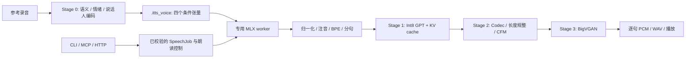

# index-tts-rs

[English](README.md) | [简体中文](README.zh-CN.md)

面向 **Apple Silicon** 的本地情感语音合成与零样本声音克隆，基于 **IndexTTS-2.5** 和 **MLX / Metal**。可以通过 `itts` 命令行、常驻模型 daemon、MCP 服务、浏览器语音工作台及 HTTP API 使用。

推理流程、DSP、文本前端和应用代码由 Rust 实现。正常合成**不需要 Python 或 PyTorch 运行时**；`mlx-rs` 调用 Apple MLX 的原生 C/C++ 后端、Metal 和 Accelerate。本项目专注于特定平台的推理，不提供模型训练工具链。

## 可以做什么

- 用一段短录音克隆声音，保存为可复用的 `.itts_voice` 快照。
- 用显式情绪、温度、语速、发音与停顿标签朗读文章、诗歌和对话。
- 逐句接收音频，后续句子继续在后台生成：支持本地播放、WAV 文件、PCM 和 JSON Lines。
- 通过 daemon，让多个 CLI 与 MCP 会话共享一份常驻模型。
- 在 shell 自动化、智能体和 HTTP 中使用统一的、经过校验的语音任务格式。
- 下载权重后在本地合成。可选的 DeepSeek 标注会把文本发送给配置的服务商；手写控制标签无需 API key。

## 环境要求与安装

**支持平台：** Apple Silicon Mac（`aarch64-apple-darwin`）。当前工作区不支持 Intel Mac、Linux、Windows 或 CUDA。语言选择包括 `zh`、`en`、`zh/en`、`ja`、`yue`、`es` 和 `ar`；实际质量取决于语言、文本与参考声音。

从源码编译需要：

- 通过 [rustup](https://rustup.rs/) 安装 Rust。仓库固定使用 **Rust 1.99.1**、2024 edition。
- 完整 Xcode，并设为当前开发者目录，包含 Metal 编译器。仅安装 Command Line Tools 可能缺少 Metal 工具。可用 `xcodebuild -version` 和 `xcrun --find metal` 检查。
- [CMake](https://cmake.org/download/)；使用 Homebrew 时可执行 `brew install cmake`。MLX 编译会拉取原生源码，首次构建需要联网。
- 约 **5 GB 模型权重磁盘空间**，另需构建产物与缓存空间。历史测试中，保存声纹的进程峰值约为 2.5 GB，直接使用参考音频约为 3.94 GB；这些是测量值，不是整机最低内存保证。

```bash
git clone https://github.com/tyrchen/index-tts-rs.git
cd index-tts-rs

# 安装优化构建的 itts，默认放入 ~/.cargo/bin。
cargo install --path apps/cli --locked
itts --version
itts --help

# 可选：同时安装仓库提供的 Codex / Claude / Gemini 技能。
make install-skill

# 编译 CLI 和 HTTP 服务，但不安装。
cargo build --release --workspace --locked
```

`make install` 会同时安装 CLI 和技能。技能安装会替换 `~/.agents/skills`、`~/.claude/skills`、`~/.gemini/config/skills` 下已有的 `itts` 目录；如果维护了自己的技能版本，仅使用 `cargo install` 即可。

仓库默认入口为[英文 README](README.md)，本文件提供对应中文说明。源码发布包及发布流程见[发布指南](docs/usage/releasing.md)。

## 第一次注册声音与合成

准备一段清晰、单人讲话的录音，建议 3–15 秒，并取得说话者授权。支持 WAV、MP3、FLAC、M4A 容器；能否解码取决于容器内的编码格式，推荐使用 WAV PCM。

```bash
# 下载 yunfengwang/IndexTTS-2.5-mlx 到 Hugging Face 缓存。
itts models pull
itts models info
itts doctor

# 只提取一次说话人条件，后续合成跳过参考音频编码器。
itts voice add narrator --ref /path/to/reference.wav
itts voice list
itts voice inspect narrator

itts synth --voice narrator \
  --text "你好，欢迎使用语音合成。" --out hello-zh.wav

# 播放是可选项；只用 --out 时不需要音频输出设备。
itts synth --voice narrator --lang en \
  --text "Hello from Apple Silicon." --out hello.wav --play
```

声音来源三选一：`--voice ID`、`--voice-file PATH.itts_voice`、`--ref AUDIO`。输出至少选择一种：`--out FILE.wav`、`--out -` 或 `--play`。

```bash
# 不注册声音，直接从录音做一次性克隆。
itts synth --ref /path/to/reference.wav \
  --text "直接使用参考录音合成。" --out cloned.wav

# Bash / Zsh：从标准输入读取脚本。
itts synth --voice narrator --stdin --out narration.wav < script.txt

# 使用导出的快照，无需在本机注册相同的声音 ID。
itts synth --voice-file /path/to/narrator.itts_voice \
  --text "复用已经提取的说话人条件。" --out snapshot.wav
```

WAV 输出为 **22,050 Hz、单声道、有符号 16 位 PCM**。`--out -` 向标准输出写入无文件头的小端 PCM，摘要写入标准错误。每个任务的文本上限为 **16,384 个 UTF-8 字节**，长文档请拆成多个任务。

## 让模型保持常驻

```bash
itts daemon start             # 自动脱离终端，模型就绪后返回；不要加 &
itts daemon ensure            # 未运行时才启动
itts synth --voice narrator --text "复用已经加载的模型。" --out warm.wav
itts daemon status
itts daemon logs -n 50
itts daemon restart           # 升级 CLI 后使用
itts daemon stop
```

`synth` 和 `voice add` 会自动使用已有 daemon，否则在当前进程加载引擎。`--no-daemon` 强制使用独立进程。默认空闲 600 秒后 daemon 自动退出；启动时设置 `--idle-timeout-secs 0` 可保持常驻。查询状态不会重置空闲计时。

默认声音目录为 `~/.cache/index-tts-rs/voices`，模型使用 Hugging Face 缓存。全局参数 `--voices-dir`、`--model-dir`、`--config` 可覆盖路径。请用准备复用的配置启动 daemon。HTTP 服务拥有独立引擎，与 daemon 同时运行会额外加载一份模型。

## 情绪与节奏控制

控制标签具有状态，会持续作用于后续文本，直到再次修改，或用 `[[reset]]` 恢复初始设置。空行保留段落与诗节边界。

```bash
itts synth --voice narrator \
  --text '[[emo=低落:0.35,平静:0.35]][[temp=0.72]][[speed=0.88]]轻轻的我走了，[[pause=600]]正如我轻轻的来。' \
  --out poem.wav

# 可选：通过服务商辅助标注，需要 DEEPSEEK_API_KEY。
itts annotate --stdin --poetry < poem.txt > poem.itts.txt
itts synth --voice narrator --stdin --out poem.wav < poem.itts.txt
```

| 控制 | 含义 |
| --- | --- |
| `[[emo=高兴:0.3,平静:0.2]]` | 混合与说话人匹配的情绪原型；`[[emo=none]]` 恢复参考声音的基础情绪 |
| `[[temp=0.72]]` | GPT 采样温度，`0.05..=2.0`；影响变化程度，不是直接的音高控制 |
| `[[speed=0.9]]` | 语速倍率，`0.25..=4.0`，越大越快 |
| `[[pause=600]]` | 插入 600 毫秒数字静音；范围 `0..=5000` 毫秒 |
| `[[voice=other_voice]]` | 切换到另一个已注册声音 |
| `[[lang=en]]` | 切换语言 |
| `[[reset]]` | 恢复初始声音与朗读参数 |
| `<行\|hang2>` | 强制指定读音；也支持英语 ARPAbet |

八类情绪支持中英文名称：高兴 / `happy`、愤怒 / `angry`、悲伤 / `sad`、恐惧 / `afraid`、反感 / `disgusted`、低落 / `melancholic`、惊讶 / `surprised`、平静 / `calm`。情绪权重是模型条件输入，不是经过标定的听感强度评分。

YAML 配置见 [config/default.yaml](config/default.yaml) 和 [config/director.yaml](config/director.yaml)。例如设置 `default_voice: narrator` 后可以省略 `--voice`，使用 `itts --config /path/to/settings.yaml synth ...` 读取配置。混合规则、服务商设置和标注限制见[语音控制指南](docs/usage/itts-speech-controls.md)。

## 智能体、JSON 与 MCP

```bash
itts doctor --output json
itts synth --voice narrator --text "你好。" --out hi.wav --output json
itts synth --voice narrator --text "第一句。第二句。" --out stream.wav --output jsonl
itts schema controls
itts schema speech-job
itts schema events
```

使用 `--output text|json|jsonl` 或 `ITTS_OUTPUT` 选择格式。JSON 合成结果包含 `status`、`backend`、`durationSecs`、`synthesisSecs`、`rtf`、`outputPath` 等字段；JSONL 按 `started` → `chunk` → `done` 流式输出。运行时错误提供稳定的 `error.code`、`message`、`hint` 和有文档说明的退出码。CLI 参数解析错误使用 Clap 的用法提示，退出码为 2。

支持 stdio 服务的 MCP 客户端可配置：

```json
{
  "mcpServers": {
    "itts": { "command": "itts", "args": ["mcp"] }
  }
}
```

确保客户端 PATH 中能找到 `itts`，也可以使用二进制绝对路径。工具包括 `status`、`describe_controls`、`synthesize`、`speak`、声音管理和 `annotate`。MCP 首次需要时启动 daemon，多个会话共享模型。工具参数、错误、进度、取消和 socket 协议见[智能体集成指南](docs/usage/itts-agent-integration.md)。

## 浏览器工作台与 HTTP

```bash
make serve
# 或：make serve SERVER_ARGS="--bind 127.0.0.1:8081 --voices-dir /path/to/voices"
```

打开 **http://127.0.0.1:8080**。先用 `itts voice add` 注册声音，工作台使用同一个声音库。页面支持编辑控制标签、语言与语速选择、流式播放、WAV 下载和可选的 DeepSeek 标注。静态资源内置，不需要 Node.js 或前端构建。

```bash
curl --fail-with-body http://127.0.0.1:8080/v1/audio/speech \
  -H 'Content-Type: application/json' \
  -d '{"input":"你好，这是 HTTP 语音接口。","voice":"narrator","lang":"zh","speed":1.0}' \
  --output speech.wav
```

| 接口 | 返回内容 |
| --- | --- |
| `GET /health` | 引擎状态和采样率 |
| `GET /api/voices` | 已注册声音 ID 与参考音频时长 |
| `POST /api/annotate` | 按源段落返回节奏标注 |
| `POST /api/speech/stream` | 包含 PCM 音频块与统计信息的 JSON Lines |
| `POST /v1/audio/speech` | 根据 `SpeechJob` 请求生成 WAV |

语音接口采用 OpenAI 风格的路径，使用本项目的请求格式，并非完整的 OpenAI API 替代实现。HTTP 仅接受已注册声音 ID，拒绝 `voiceFile`、`refAudio`、`outputPath`。请求体上限为 32 KiB，单次请求超时 120 秒，同时接入请求上限为八个。服务没有内置鉴权，默认绑定本机回环地址；远程部署需要有鉴权的网关。这些限制控制接入工作量，GPU worker 仍串行推理。

## 产品决策与架构

目标是让个人和智能体方便地使用本地语音：反复调用不应反复加载模型，情感表达应当可复现、可编辑。

| 决策 | 原因与取舍 |
| --- | --- |
| 专注 Apple Silicon 与 MLX | Metal 和统一内存适合 Mac 本地推理；选择 `mlx-rs` 可复用 MLX 量化算子和权重布局，代价是平台覆盖有限。 |
| 保存 `.itts_voice` 条件快照 | 复用 Stage 0 的四个输出张量，避免每次运行大型参考编码器。快照依赖模型与格式，不是通用说话人 embedding。 |
| 一个 actor 拥有 GPU 状态 | MLX 状态放在专用线程，有界通道提供背压，支持在句子边界取消；多个请求排队执行，不并行抢占 GPU 推理。 |
| 通过本机 socket 使用常驻 daemon | 短生命周期的 CLI / MCP 进程复用模型，以常驻内存换取更低启动延迟。 |
| 统一服务层任务模型 | CLI、daemon、MCP、HTTP 共享校验、控制标签、事件和错误码；HTTP 额外限制文件访问。 |
| 显式行内控制标签 | 脚本可检查、可编辑；自动标注只提出标签，合成本身不依赖 LLM 服务。 |
| 按句流式输出 | 每句完成完整声学流程后交付音频；改善首包延迟，但不是逐 token 波形输出。更短分段可能影响韵律和吞吐。 |



性能背后的主要技术选择：

- **少加载权重：** 先读取 SafeTensors 元数据，只流式加载推理会使用的张量，跳过未使用的语义编码层和 codec 编码器权重。Stage 0 编码器逐个加载、提取后释放。
- **复用条件：** 快照存储 `conds`、`prompt_condition`、`ref_mel`、`style`。历史测试中，8.14 秒参考录音生成 1.60 MiB 快照，实际大小随录音长度变化。
- **减少 GPU 工作：** GPT 复用预分配 KV cache；CFM 使用 RoPE 与 SwiGLU 融合；BigVGAN 使用多相 Kaiser-Sinc 上采样；显式求值边界控制 MLX 计算图深度与中间激活生命周期。
- **明确系统边界：** 域类型校验、有界队列、结构化事件，工作区各 crate 使用 `#![forbid(unsafe_code)]`；原生依赖仍包含其自身的 FFI 和底层实现。

工作区分为 [`core`](crates/core)（DSP、前端、模型、actor、声音库）、[`director`](crates/director)（朗读控制与标注）、[`service`](crates/service)（任务与错误）、[`cli`](apps/cli)、[`server`](apps/server)。张量布局及设计细节见[架构研究](docs/research/indextts-2.5-mlx-architecture-and-backend-research.md)与[规格索引](specs/index.md)。

## Benchmark 与数值验证

下列数字来自仓库内的[历史性能报告](docs/benchmarks/indextts-rust-verification-and-benchmark-report.md)，**不代表每个发布版本都重新测得的成绩**。报告记录的条件为 macOS / Apple Silicon、MLX `0.33.0`、Python 包 `0.1.1`、模型快照 `660a09b98cf667130831e73d7d49d66de1236645`、8.1386 秒参考音频、中文测试文本、greedy 解码、25 步 CFM、CFG 0.7。输出为 22,050 Hz、10.019410 秒音频。

| 运行方式 | 总挂钟耗时 | 纯合成耗时 | 合成 RTF | 进程峰值 RSS |
| --- | ---: | ---: | ---: | ---: |
| Python `uvx`，参考音频 | 15.43 s | 5.280 s | 0.527 | 5.16 GB |
| Python 本地模型缓存，参考音频 | 6.15 s | 4.320 s | 0.431 | 5.38 GB |
| Rust 独立进程，参考音频 | 4.93 s | 3.850 s | 0.384 | 3.94 GB |
| Rust 独立进程，已保存声纹 | 4.36 s | 3.853 s | 0.385 | 2.50 GB |
| Rust 常驻 daemon，已保存声纹 | 3.85 s | 3.848 s | 0.384 | daemon 2.50 GB；客户端 14.5 MB |

**RTF = 合成耗时 / 生成音频时长**，小于 1 表示快于实时。包含启动和声音准备的端到端 RTF：Rust 参考音频模式为 0.492，声纹模式为 0.435，常驻 daemon 为 0.384。daemon 相对 `uvx` 的 4.01 倍挂钟加速包含不同的启动和声音准备成本；相对本地缓存 Python 约为 1.60 倍，不能解释为 GPU 算子加速了四倍。

另一项四个音频块的流式测试记录了 **1.85 秒首包延迟**，用 **7.33 秒**生成 **15.62 秒**音频（RTF 0.469）。它是独立的分段任务，不能直接与上表的单次输出案例比较。

历史 Criterion CPU 微基准中，处理两秒音频的估计耗时分别为：重采样 1.865 ms、Mel 提取 5.159 ms、CAMPPlus Fbank 2.467 ms、W2V 特征 2.584 ms；token 采样为 11.07 µs，中英混排文本准备为 11.00 µs。这些微基准不衡量端到端 GPU 合成速度。

报告还记录了相对 Python 导出夹具的 **14 个黄金检查点**：分词序列与 32 步 greedy GPT token 精确一致，DSP 与声学阶段按误差阈值比较，最终波形 SNR 超过 58 dB。数值对齐不等同于人工听感研究、ASR 质量评分，也不保证随机采样的音频完全相同。

**测量局限：** 历史报告没有记录具体芯片 / 内存、系统构建号、多轮统计或实现 commit，私人参考录音也未随仓库分发。因此这些数值只能说明特定工作负载下的历史结果，不能作为通用硬件承诺或完整可复现的性能认证。

测量自己的环境：

```bash
cargo build --release --workspace --locked
itts voice add bench_voice --ref /path/to/reference.wav

# 独立进程；macOS 的 /usr/bin/time -l 提供挂钟时间与峰值 RSS。
/usr/bin/time -l itts synth --voice bench_voice \
  --text "你好，欢迎使用 IndexTTS Rust 原生语音合成引擎！今天天气真不错，我们一起来测试一下语音克隆的速度和音质表现。" \
  --greedy --no-daemon --out bench.wav --output json

itts daemon start
# 相同请求去掉 --no-daemon，测量模型常驻时的延迟。
/usr/bin/time -l itts synth --voice bench_voice \
  --text "你好，欢迎使用 IndexTTS Rust 原生语音合成引擎！今天天气真不错，我们一起来测试一下语音克隆的速度和音质表现。" \
  --greedy --out bench-warm.wav --output json
itts daemon stop

make bench
```

请使用刚编译的二进制（通常为 `target/release/itts`，或你配置的 Cargo target 目录），或用 `cargo install --path apps/cli --locked` 重新安装。记录芯片、内存、macOS、commit、模型快照、录音 / 文本哈希、配置、预热策略，并运行多轮。daemon 内存需要单独测量，计时客户端无法测得常驻模型的 RSS。前端微基准和模型测试需要缓存权重，仅凭轻量测试成功不能认定模型数值对齐已通过。

## 常见问题

| 现象 | 下一步 |
| --- | --- |
| 模型缺失或不可用 | 运行 `itts models pull` 和 `itts doctor --output json`；已有快照可通过 `--model-dir` 指定。 |
| 找不到声音 ID | 用 `itts voice list` 查看，或用 `itts voice add ID --ref AUDIO` 注册。 |
| 升级后 daemon 版本不匹配 | 执行 `itts daemon restart`。 |
| 没有播放设备 | 使用 `--out` 保存 WAV，省略 `--play`。 |
| 构建时找不到 Metal 编译器 | 将完整 Xcode 设为当前开发者目录，再检查 `xcrun --find metal`。 |
| 无法自动标注 | 为标注配置 `DEEPSEEK_API_KEY`，或直接手写行内控制标签。 |

`itts doctor` 会提供修复提示。设置 `ITTS_LOG=debug` 可开启诊断日志，daemon
日志可通过 `itts daemon logs` 查看。

## 开发与验证

```bash
make build                   # 整个工作区及全部 targets
make test                    # cargo test：单元、集成与文档测试
make verify-models           # 需要缓存权重与黄金夹具
make lint                    # nightly 格式检查与严格 Clippy
make audit                   # cargo-audit 与 cargo-deny
make check-agent-sync        # 项目指引和镜像技能同步
make package                 # 验证可分发的工作区源码 crate
make release-check           # 全部发布门禁，不上传、不推送
```

`lint` 需要 nightly rustfmt，`audit` 需要 `cargo-audit`、`cargo-deny`。可选的 `make test-nextest` 需要 `cargo-nextest`，也会运行文档测试。部分黄金测试在缺少权重时会提前返回，应先执行 `itts models pull`，再用 `make verify-models` 检查前置条件并运行黄金检查和 ignored 测试。明确标记为 ignored 的模型与 HTTP 测试可在准备好的 Mac 上运行 `cargo test --workspace -- --ignored --test-threads=1`。夹具重新生成是独立的 Python 研究流程（`make generate-fixtures PYTHON_BIN=/path/to/python`），不属于运行时依赖。

在支持的 Mac 上运行 `cargo doc --workspace --no-deps --open` 生成 API 文档。MLX 需要 macOS 原生工具，Linux docs.rs 构建不是受支持的文档路径。CI 在 Apple Silicon 上执行构建、测试、lint、审计和打包验证；标签发布附带经过验证的 `.crate` 源码包与校验和。更多信息见[发布指南](docs/usage/releasing.md)、[文档索引](docs/index.md)、[规格索引](specs/index.md)和[更新日志](CHANGELOG.md)。

## 许可与致谢

本项目 Rust 源码采用 [MIT 许可](LICENSE.md)。**模型权重与模型派生资产使用独立条款：** 内置情绪原型和黄金夹具源自 IndexTTS，详见[资产声明](crates/core/assets/README.md)及随附的 [bilibili 模型使用许可协议](crates/core/assets/LICENSE-INDEXTTS)。MIT 许可不改变这些资产的许可。下载权重遵循 [MLX 模型说明](https://huggingface.co/yunfengwang/IndexTTS-2.5-mlx)与上游模型条款；使用参考录音前请取得说话者授权。

感谢 [IndexTTS 作者](https://github.com/index-tts/index-tts)、[MLX 权重转换项目](https://huggingface.co/yunfengwang/IndexTTS-2.5-mlx)、[Apple MLX](https://github.com/ml-explore/mlx) 和 [`mlx-rs`](https://github.com/oxiglade/mlx-rs)。本项目是独立实现，未经上游模型作者背书。模型派生作品要求保留的声明见[资产说明](crates/core/assets/README.md)。
