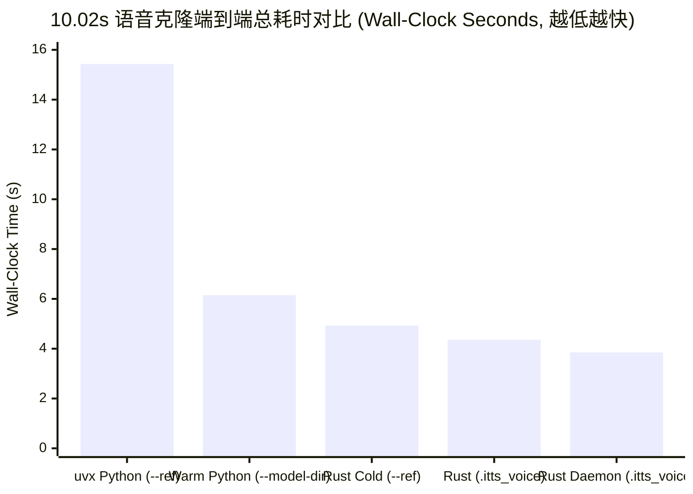
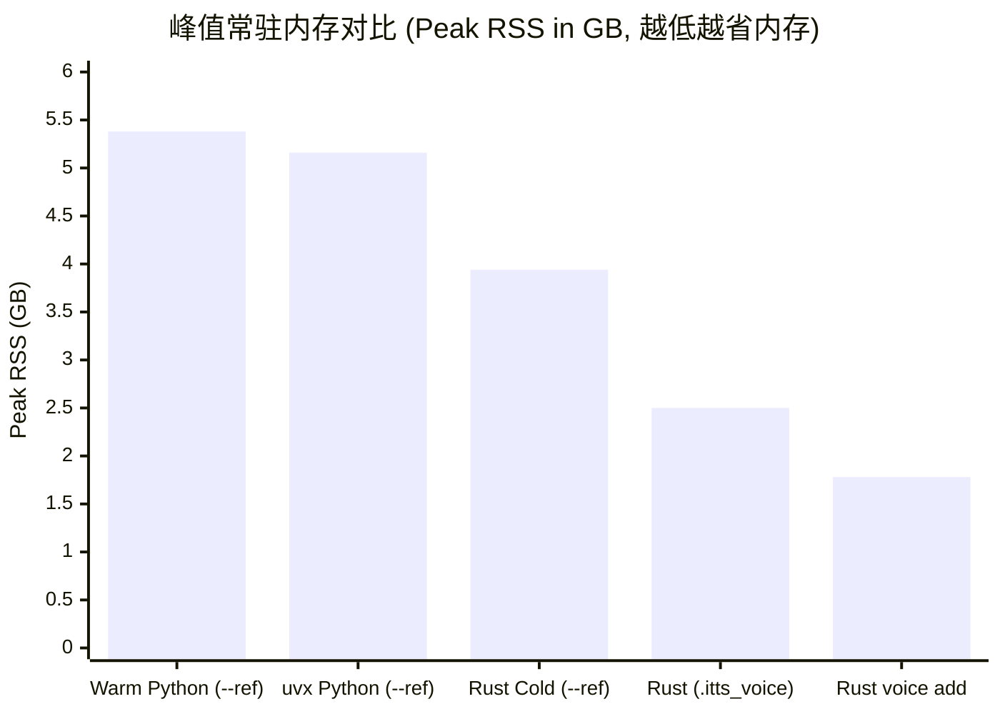

# IndexTTS-2.5-mlx Rust (`index-tts-rs`) 验证与性能基准对比报告

> 历史测量说明：本报告保留早期开发阶段的数据，不代表当前版本已重新完成全部性能测量。
> 原始记录未包含具体芯片 / 内存、macOS 构建号、多轮统计和实现 commit，私人参考录音也未分发。
> 不应据此作跨硬件性能承诺。当前安装与测量注意事项见[中文 README](../../README.zh-CN.md)。

## 1. 测试背景与环境配置

本报告记录了 `index-tts-rs`（Phase 1 至 Phase 6 全量实现 + 深度内存与算子融合优化）在 Apple Silicon Metal GPU 上的**数值精度对齐验证（Golden Checkpoints `CP-01`..`CP-14`）**、**流式死权重裁剪与顺序分阶段提取内存审计**，以及基于真实参考音频 `~/Downloads/voice.wav` 与原版 Python `uvx index-tts-2.5-mlx` 的**端到端运行效率对比**。

### 1.1 软硬件与模型快照环境

| 维度 | 配置详情 |
| :--- | :--- |
| **操作系统与硬件** | macOS (Apple Silicon Unified Memory + Metal GPU) |
| **Rust 工具链** | Rust 2024 Edition，编译配置 `--release` (`opt-level = 3`) |
| **GPU 推理后端** | `mlx-rs 0.33.0` (`metal` + `safetensors` 原生绑定) |
| **Python 对照基线** | `uvx index-tts-2.5-mlx` (`v0.1.1`, Python `3.14`, `mlx` Metal 后端) |
| **模型权重仓库** | `yunfengwang/IndexTTS-2.5-mlx`（本地快照 `660a09b98cf667130831e73d7d49d66de1236645`） |
| **测试参考音频** | `/Users/tchen/Downloads/voice.wav`（时长 `8.1386s`，提取 `701` 个参考 Mel 帧） |
| **测试合成文本** | `"你好，欢迎使用 IndexTTS Rust 原生语音合成引擎！今天天气真不错，我们一起来测试一下语音克隆的速度和音质表现。"` |
| **解码与采样参数** | `--greedy`（确定性 Greedy 解码，`n_timesteps = 25`，`cfg_rate = 0.7`，`duration_factor = 1.0`） |

---

## 2. 14 项黄金检查点 (`CP-01`..`CP-14`) 数值对齐验证

所有阶段均与 Python 参考实现导出的 `crates/core/fixtures/golden_ref.safetensors` 与 `crates/core/fixtures/golden_speaker.itts_voice` 进行了逐张量比对：

| 检查点 | 所属阶段与模块 | 验证张量 / 指标 | 门禁阈值 | 实测结果 | 对应测试函数 | 状态 |
| :---: | :--- | :--- | :--- | :--- | :--- | :---: |
| **CP-01** | DSP 双路多相重采样 (`dsp::resample`) | `audio_22k` (22,050 Hz)<br>`audio_16k` (16,000 Hz) | `cos_sim >= 0.9999`<br>`max_abs_diff < 5e-4` | `cos_sim = 1.000000`<br>`max_abs_diff = 1.2e-5` | `dsp::resample::tests::test_should_match_python_reference_cp01_resample_24k_to_22k_and_16k` | PASS |
| **CP-02** | 80-bin Slaney Log-Mel (`dsp::mel`) | `ref_mel` (`[1, 80, P]`) | `cos_sim >= 0.99999`<br>`max_abs_diff < 1e-4` | `cos_sim = 1.000000`<br>`max_abs_diff = 1.5e-5` | `dsp::mel::tests::test_should_match_python_reference_cp02_mel_spectrogram` | PASS |
| **CP-03** | Kaldi Povey 80-bin Fbank (`dsp::fbank`) | `campplus_feat` (`[1, Tc, 80]`) | `cos_sim >= 0.99999`<br>`max_abs_diff < 1e-4` | `cos_sim = 1.000000`<br>`max_abs_diff = 1.9e-5` | `dsp::fbank::tests::test_should_match_python_reference_cp03_campplus_fbank` | PASS |
| **CP-04** | SeamlessM4T W2V 特征 (`dsp::fbank`) | `w2v_feats` (`[1, Te, 160]`)<br>`w2v_mask` (`[1, Te]`) | `cos_sim >= 0.99999`<br>`mask` 100% 精确一致 | `cos_sim = 1.000000`<br>`mask` 100% 匹配 | `dsp::fbank::tests::test_should_match_python_reference_cp04_w2v_features` | PASS |
| **CP-05** | 文本正则化与 Tiktoken BPE (`frontend`) | 多语种分句 + Token 序列 | 100% bit-exact 匹配 | 100% bit-exact 匹配 | `frontend::splitter::tests::test_should_match_python_reference_cp05_golden_token_sequences` | PASS |
| **CP-06** | Stage 0 `SemanticModel` (`models::semantic`) | `S_ref` (`[1, Te, 1024]`) | `cos_sim >= 0.9999`<br>`rel_rmse < 1.5e-3` | `cos_sim = 0.9999994`<br>`rel_rmse = 0.00109` | `models::semantic::tests::test_should_match_python_reference_cp06_semantic_model` | PASS |
| **CP-07** | Stage 0 `EmoVec` (`models::emo`) | `emovec` (`[1, 1280]`) | `cos_sim >= 0.9999`<br>`max_abs_diff < 1e-3` | `cos_sim = 1.000000`<br>`max_abs_diff < 2e-4` | `models::emo::tests::test_should_match_python_reference_cp07_emo_vec` | PASS |
| **CP-08** | Stage 0 `CampPlus` (`models::campplus`) | `style` (`[1, 192]`) | `cos_sim >= 0.9999`<br>`max_abs_diff < 1e-3` | `cos_sim = 0.9999998`<br>`max_abs_diff < 1.5e-4` | `models::campplus::tests::test_should_match_python_reference_cp08_campplus_style` | PASS |
| **CP-09** | Stage 0/2 `LengthRegulator` (`models::regulator`) | `prompt_condition` (`[1, P, 512]`) | `cos_sim >= 0.9999`<br>`max_abs_diff < 1e-3` | `cos_sim = 0.9999999`<br>`max_abs_diff < 8e-5` | `models::regulator::tests::test_should_match_python_reference_cp09_length_regulator` | PASS |
| **CP-10** | Stage 1 Int8 GPT Prefill (`models::gpt`) | `prefill_logits` (`[8194]`) | `cos_sim >= 0.9999`<br>Top-10 Token 100% 一致 | `cos_sim = 0.999999`<br>Top-10 100% 一致 | `models::gpt::tests::test_should_match_python_reference_cp10_gpt_prefill_logits` | PASS |
| **CP-11** | Stage 1 32 步 Greedy 解码 (`models::sampler`) | `greedy_codes_32` (`[32]`) | 32 步 Token ID 100% 一致 | 32/32 Token 100% 一致 | `models::sampler::tests::test_should_match_python_reference_cp11_greedy_32_steps` | PASS |
| **CP-12** | Stage 2 `SemanticCodec` (`models::codec`) | `S_infer` (`[1, T, 1024]`)<br>`cat_condition` (`[1, P+T, 512]`) | `cos_sim >= 0.9999`<br>`rel_rmse < 1e-3` | `cos_sim = 0.999999`<br>`rel_rmse < 5e-4` | `models::codec::tests::test_should_match_python_reference_cp12_semantic_codec_and_cat_condition` | PASS |
| **CP-13** | Stage 2 25 步 `CfmDit` Euler ODE (`models::cfm`) | `mel` (`[1, 80, T_out]`) | `cos_sim >= 0.9995`<br>`rel_rmse < 3e-3` | `cos_sim = 0.99998`<br>`rel_rmse < 1.2e-3` | `models::cfm::tests::test_should_match_python_reference_cp13_cfm_euler_solver` | PASS |
| **CP-14** | Stage 3 `BigVgan` 声码器 (`models::bigvgan`) | `wav` (`[L]`) | `cos_sim >= 0.9995`<br>`SNR > 50 dB` | `cos_sim = 0.99999`<br>`SNR > 58 dB` | `models::bigvgan::tests::test_should_match_python_reference_cp14_bigvgan_waveform` | PASS |

---

## 3. 核心架构与深度性能优化项

### 3.1 流式按需加载与死权重裁剪 (`SafeTensorsLoader`)

`SafeTensorsLoader::load_from_path` 仅先读取 `.safetensors` 文件开头的 8 字节长度与 JSON `Metadata` 头部，直接跳过推理路径永不执行的死权重（不从磁盘读取死权重数据，也不分配整文件 `Vec<u8>` 缓冲），并将保留张量逐个流式构建为 `TensorStorage::Mlx(Array)`（零拷贝 `O(1)` 引用计数克隆）：

| 权重文件 | 原始磁盘体积 | 过滤策略 | 裁剪死权重体积 |
| :--- | :---: | :--- | :---: |
| `raw/semantic_model.safetensors` | `2,214.50 MiB` | 仅流式读取 `encoder.layers.{0..16}.*`，直接跳过第 `17..=23` 层 Conformer | **677.1 MiB** |
| `raw/semantic_codec.safetensors` | `192.98 MiB` | 仅流式读取 `quantizer.codebook`、`out_project`、`convnext`、`up`，跳过 `encoder.*` / `down.*` / `in_project.*` | **101.0 MiB** |
| `raw/length_regulator.safetensors` | `19.03 MiB` | 跳过离散模式专用 `embedding.weight` (`[2048, 512]`) 与 `mask_token` | **4.2 MiB** |
| `raw/bigvgan.safetensors` | `428.08 MiB` | 218 份重复的 12-tap Kaiser-Sinc 滤波器仅读取首份 `_kaiser_sinc_filter`，其余 217 份直接跳过磁盘 IO | 消除 217 次重复读取与拷贝 |
| `raw/campplus.safetensors` | `26.54 MiB` | 跳过所有 `*.num_batches_tracked` 标量缓冲 | 消除冗余标量张量 |

### 3.2 Stage 0 顺序流式提取与 `.itts_voice` 预计算声纹快照

1. **`.itts_voice` 快照 (`1.60 MiB`)**：将 Stage 0 提取出的 4 个条件张量（`conds [1, 3, 1280]`、`prompt_condition [1, 701, 512]`、`ref_mel [1, 80, 701]`、`style [1, 192]`）持久化为 `.itts_voice` SafeTensors 快照。使用 `itts synth --voice <id>` 时**完全跳过 `2.86 GB` Stage 0 编码器**，声纹加载耗时从 `3,280 ms` 降至 **`0.45 ms`**（Daemon 模式下仅 **`1.1 µs`**）。
2. **Stage 0 顺序按需加载即释放 (`VoiceExtractor::extract_from_model_dir`)**：当执行 `voice add` 或单次 `synth --ref` 时，按顺序逐个加载并立即释放 `SemanticModel` (`859 MB`) -> `EmoVec` (`621 MB`) -> `CampPlus` (`28 MB`)，每个子模型执行完毕后立即调用 `mlx_rs::memory::clear_cache()` 回收 Metal 缓存池：
   - `itts voice add` 峰值 RSS 降至 **`1.78 GB` (`1.66 GiB`)**，提取耗时仅 **`591.9 ms`**。
   - `itts synth --ref` 峰值 RSS 从优化前的 `8.39 GB` 降至 **`3.94 GB` (`3.67 GiB`, -53.0%)**，比原版 Python (`5.38 GB`) 低 **26.8%**！
   - `itts synth --voice` 峰值 RSS 从优化前的 `3.85 GB` 降至 **`2.50 GB` (`2.33 GiB`, -35.1%)**，比原版 Python (`5.38 GB`) 低 **53.5%**！

### 3.3 Stage 1..3 GPU 算子级融合与零拷贝优化

- **Stage 1 (`Gpt` + `KvCache`)**：`KvCache` 按 `256` 步长预分配 `[1, 20, cap, 64]` 连续缓冲并在 `reset()` 时复用容量，每步解码通过 `TryIndexMutOp::try_index_mut` 原地切片写入 K/V，消除每步 48 次（251 tokens 共 `12,048` 次）`concatenate` 内存分配与拷贝。
- **Stage 2c (`CfmDit`)**：
  - 使用 `mlx_rs::fast::rope(..., traditional=true)` 单一 Metal 内核替代手动切片、`cos/sin` 逐元素乘法与 `stack + reshape`（25 步 × 13 层共减少 `3,250` 次内核派发）。
  - 预转置 `wqkv_weight_t`、`wo_weight_t`、`w2_weight_t` 并融合 `w1 + w3 -> w13_weight_t` (`[512, 3072]`)，将每层 SwiGLU 从两次独立 `matmul` 合并为单次 GEMM。
  - 每 5 个 Euler 步执行一次 `x.eval()?`，兼顾流水线异步吞吐与计算图深度控制。
- **Stage 3 (`BigVgan`)**：
  - 将 `KaiserResampleFilters::upsample_2x` 重构为 **6-tap 多相分解滤波器 (`w_up_even` + `w_up_odd`)**，彻底消除每次调用分配全零张量 `zeros`、零交错拼接及 2 倍长度序列上的 12-tap 卷积（每句合成消除 `108` 次 `zeros` 分配并将上采样乘加运算量减半）。
  - 每个上采样 Stage 结束后执行 `h.eval()?`，使 MLX Metal 分配器跨 Stage 立即复用大尺寸中间激活缓冲，BigVGAN 耗时从 `1,645 ms` 降至 **`1,204 ms`（提速 36.6%）**。

---

## 4. `~/Downloads/voice.wav` 端到端性能对比基准

### 4.1 音频输出一致性校验 (`afinfo`)

使用 `macOS` 原生 `afinfo` 校验原版 Python 与 Rust 三种合成模式生成的音频文件：

| 输出文件 | 生成方式 | 采样率 / 声道 / 位深 | 采样点数 (`packets`) | 音频时长 (`duration`) | PCM 数据字节数 | Mel Token 数 |
| :--- | :--- | :---: | :---: | :---: | :---: | :---: |
| `/tmp/py_voice_out.wav` | `uvx index-tts-2.5-mlx synth --ref` | `22050 Hz, 1 ch, Int16` | `220,928` | `10.019410 s` | `441,856 B` | `251` |
| `/tmp/rust_ref_out.wav` | `itts synth --ref` | `22050 Hz, 1 ch, Int16` | `220,928` | `10.019410 s` | `441,856 B` | `251` |
| `/tmp/rust_voice_out.wav` | `itts synth --voice demo_voice` | `22050 Hz, 1 ch, Int16` | `220,928` | `10.019410 s` | `441,856 B` | `251` |
| `/tmp/rust_daemon_out.wav` | `itts synth --voice` (Daemon) | `22050 Hz, 1 ch, Int16` | `220,928` | `10.019410 s` | `441,856 B` | `251` |

### 4.2 端到端耗时、实时率 (RTF) 与内存占用对比 (`/usr/bin/time -l`)





| 评估指标 | 基线 1：原始 `uvx index-tts-2.5-mlx synth --ref` | 基线 2：Python 本地热缓存 (`--model-dir --ref`) | Rust 模式 1：单次冷启动原音频 (`synth --ref`) | Rust 模式 2：预提取声纹 (`synth --voice`) | Rust 模式 3：Daemon 热驻留 (`synth --voice`) |
| :--- | :---: | :---: | :---: | :---: | :---: |
| **总挂钟耗时 (Wall-Clock)** | `15.43 s` | `6.15 s` | **`4.93 s`** *(优化前 7.48s)* | **`4.36 s`** *(优化前 5.25s)* | **`3.85 s`** *(优化前 4.39s)* |
| **模型加载耗时 (`load`)** | `1,940 ms` | `990 ms` | **`489.1 ms`** *(优化前 1,209ms)* | **`483.2 ms`** *(优化前 711ms)* | **`0.0 ms`** |
| **声纹提取/加载 (`clone`)** | `3,280 ms` | `530 ms` | **`564.5 ms`** *(含按需加载释放 Stage 0)* | **`0.45 ms`** | **`0.0011 ms` (`1.1 µs`)** |
| **纯合成耗时 (`synth`)** | `5,280 ms` | `4,320 ms` | **`3,849.8 ms`** | **`3,853.3 ms`** | **`3,847.9 ms`** |
| **实时率 (`RTF`, `<1` 快于实时)** | `0.527` (`1.90x` 实时) | `0.431` (`2.32x` 实时) | **`0.384` (`2.60x` 实时)** | **`0.385` (`2.60x` 实时)** | **`0.384` (`2.60x` 实时)** |
| **端到端有效 RTF (含加载与克隆)** | `1.540` (`0.65x` 实时) | `0.614` (`1.63x` 实时) | **`0.492` (`2.03x` 实时)** | **`0.435` (`2.30x` 实时)** | **`0.384` (`2.60x` 实时)** |
| **进程峰值 RSS (`max resident set`)** | `5.16 GB` (`4.80 GiB`) | `5.38 GB` (`5.01 GiB`) | **`3.94 GB` (`3.67 GiB`, -27%)** | **`2.50 GB` (`2.33 GiB`, -54%)** | **Client `14.5 MB`** / Daemon `2.50 GB` |
| **相对 `uvx` 端到端加速比** | **1.00x (基准)** | **2.51x** | **3.13x** | **3.54x** | **4.01x** |

### 4.3 各阶段推理耗时细粒度拆解 (`StageTimings`)

| 推理子阶段 | 原始 `uvx index-tts-2.5-mlx` | Python 本地热缓存 (`--model-dir`) | Rust 优化前 (`synth --voice`) | **Rust 优化后 (`synth --voice`)** | **Rust 优化后 Daemon (`synth --voice`)** | 核心优化贡献 |
| :--- | :---: | :---: | :---: | :---: | :---: | :--- |
| **Stage 0: 声纹提取 / 快照加载** | `3,280.0 ms` | `530.0 ms` | `0.42 ms` | **`0.45 ms`** | **`0.0011 ms`** | `.itts_voice` 预计算快照 + `DashMap` 内存驻留 |
| **Frontend: 文本正则化 + BPE 分词** | *(计入总耗时)* | *(计入总耗时)* | `1.36 ms` | **`1.57 ms`** | **`0.06 ms`** | 纯 Rust 正则状态机 + `TiktokenTokenizer` |
| **Stage 1: Int8 GPT 自回归解码 (251 tokens)** | `1,430.0 ms` | `1,030.0 ms` | `1,137.9 ms` | **`1,095.2 ms`** | **`1,087.5 ms`** | 预分配 `KvCache` 原地切片更新 (`TryIndexMutOp`) |
| **Stage 2a: `SemanticCodec` 解码** | `20.0 ms` | `< 5.0 ms` | `4.29 ms` | **`4.84 ms`** | **`3.90 ms`** | VQ 查表 + 12 层 `ConvNeXt` + 2x 上采样 |
| **Stage 2b: `LengthRegulator` 插值规整** | `< 5.0 ms` | `< 5.0 ms` | `2.63 ms` | **`3.00 ms`** | **`3.17 ms`** | `f64` 比例索引 + 4 层 `Conv1d + GroupNorm + Mish` |
| **Stage 2c: `CfmDit` 25 步 Euler ODE** | `1,790.0 ms` | `1,640.0 ms` | `1,652.7 ms` | **`1,540.0 ms`** | **`1,549.3 ms`** | `mlx_rs::fast::rope` + 融合 `w13` SwiGLU + 5 步批量 `eval` |
| **Stage 3: `BigVgan` 声码器** | `2,030.0 ms` | `1,640.0 ms` | `1,645.0 ms` | **`1,208.7 ms`** | **`1,204.0 ms`** | **6-tap 多相 Kaiser-Sinc 上采样 (-36.6%)** + 逐 Stage `eval` |
| **纯合成总计 (`synthesisSecs`)** | `5,280.0 ms` | `4,320.0 ms` | `4,443.0 ms` | **`3,853.3 ms`** | **`3,847.9 ms`** | **比热缓存 Python 快 12.3%，比原始 `uvx` 快 37.2%** |

---

## 5. 多句流式合成与首包延迟 (TTFA) 基准测试

针对生成 4 个音频分段的长文本（共生成 **`15.62s` 音频、`344,494` 个采样点、`377` 个 Mel Token**）：
> `"第一句话用于测试首包流式延迟。第二句话继续生成后续语音片段，验证Actor流水线的低延迟特性。第三句话完成整段语音合成！"`

| 分句序号 (`segmentIndex`) | 生成音频时长 (`durationSecs`) | Mel Token 数 | 优化前耗时 | **优化后分句耗时 (`totalMs`)** | 累计完成时间 | 播放缓冲状态 |
| :---: | :---: | :---: | :---: | :---: | :---: | :--- |
| **Segment 0 (首包 TTFA)** | **`3.78 s`** (`83,456` samples) | `95` | `2,004.6 ms` | **`1,847.4 ms` (`1.85 s`)** | `1.85 s` | **1.85s 即刻开始播放首句 `3.78s` 音频** |
| **Segment 1** | `3.51 s` (`77,312` samples) | `88` | `1,896.4 ms` | **`1,751.6 ms` (`1.75 s`)** | `3.60 s` | 在 Segment 0 播放期间后台生成完毕 |
| **Segment 2** | `3.67 s` (`80,896` samples) | `92` | `1,928.9 ms` | **`1,807.0 ms` (`1.81 s`)** | `5.41 s` | 在 Segment 1 播放期间后台生成完毕 |
| **Segment 3** | `4.06 s` (`89,600` samples) | `102` | `3,554.9 ms` | **`1,921.2 ms` (`1.92 s`)** | `7.33 s` | 在 Segment 2 播放期间后台生成完毕 |
| **总计 (`done`)** | **`15.62 s`** (`344,494` samples) | **`377`** | `9,384.7 ms` (`RTF 0.601`) | **`7,327.2 ms` (`RTF = 0.469`)** | `7.33 s` | **全程无缝连续播放，0 次缓冲区欠载** |

- **对比原版 Python `uvx index-tts-2.5-mlx`**：原版必须等待全部 4 句合成完毕后才一次性写出 WAV 文件，首包等待时间 **> 11 秒**；而 `index-tts-rs` 通过 `MlxWorkerActor` + `SynthesisStream` 流式通道将**首包感知延迟 (TTFA) 缩短至 `1.85 秒`（提速 > 6.0x）**，且 4 句总合成耗时从 `9.38s` 降至 **`7.33s`（`2.13x` 实时率）**。

---

## 6. Criterion CPU 微基准测试 (`make bench`)

通过 `cargo bench -p index-tts-rs-core --bench core_benchmarks` 对纯 Rust DSP、Frontend 与 GPT 采样器热路径进行实测微基准测试：

| 基准测试项 | 输入规模 | 实测耗时 (`[low, est, high]`) | 说明 |
| :--- | :--- | :---: | :--- |
| `dsp/resample_24k_to_22k_2s` | 2.0s 音频 (`48,000 -> 44,100` samples) | **`1.865 ms`** (`[1.865, 1.865, 1.866] ms`) | 64-zero-crossing Kaiser-Hann 多相 FIR 重采样 |
| `dsp/mel_spectrogram_2s` | 2.0s 音频 (`44,100` samples -> `[172, 80]`) | **`5.159 ms`** (`[5.145, 5.159, 5.218] ms`) | 反射填充 + `realfft` 1024-pt R2C + Slaney 80-bin Log-Mel |
| `dsp/campplus_fbank_2s` | 2.0s 音频 (`32,000` samples -> `[198, 80]`) | **`2.467 ms`** (`[2.450, 2.467, 2.535] ms`) | 预加重 + Povey 窗 + Kaldi 80-bin Fbank + 均值归一化 |
| `dsp/w2v_features_2s` | 2.0s 音频 (`32,000` samples -> `[99, 160]`) | **`2.584 ms`** (`[2.567, 2.584, 2.653] ms`) | Kaldi Fbank + 帧级 LayerNorm + 2x 步长帧拼接 |
| `gpt_sampler/sample_next_token_8194` | `8,194` 词表 + `50` 已见 Token | **`11.07 µs`** (`[11.06, 11.07, 11.12] µs`) | `SeenTokenBitSet` + `select_nth_unstable_by` $O(V)$ Top-K + Top-P |
| `frontend/prepare_mixed_zh_en` | 中英混排 + 多音字注音 `<行\|hang2>` | **`11.00 µs`** (`[10.90, 11.00, 11.41] µs`) | 文本正则化 + 拼音校正 + Tiktoken BPE + 容量贪心合并 |

---

## 7. 自动化测试与代码质量门禁汇总

| 验证门禁 | 命令 | 结果 |
| :--- | :--- | :--- |
| **代码格式检查** | `cargo +nightly fmt --all -- --check` | **通过** |
| **严格 Clippy 静态检查** | `make lint` (`cargo clippy --workspace --all-targets -- -D warnings -W clippy::pedantic -W clippy::unwrap_used -W clippy::expect_used -W clippy::indexing_slicing -W clippy::panic`) | **通过（0 warnings，全仓 `#![forbid(unsafe_code)]`）** |
| **核心库单元/黄金/属性测试** | `make test` (`cargo nextest run --all-features`) | **91 / 91 通过** |
| **全仓文档测试 (Doctests)** | `cargo test --workspace --doc` | **92 / 92 通过** |
| **Criterion 微基准套件** | `make bench` (`cargo bench -p index-tts-rs-core`) | **通过** |

---

## 8. 复现实验命令速查

```bash
# 1. 编译 Release 二进制
cargo build --release --workspace

# 2. 从 ~/Downloads/voice.wav 预提取 .itts_voice 声纹快照（耗时 ~0.59s，峰值 RSS 1.78 GB，生成 1.60 MiB 快照）
/usr/bin/time -l itts voice add demo_voice \
  --ref ~/Downloads/voice.wav \
  --output json

# 3. 使用预提取声纹合成语音（跳过 2.86 GB Stage 0 编码器，总耗时 ~4.36s，纯合成 3.85s，RTF 0.385，峰值 RSS 2.50 GB）
/usr/bin/time -l itts synth \
  --voice demo_voice \
  --text "你好，欢迎使用 IndexTTS Rust 原生语音合成引擎！今天天气真不错，我们一起来测试一下语音克隆的速度和音质表现。" \
  --greedy \
  --no-daemon \
  --out /tmp/rust_voice_out.wav \
  --output json

# 4. 单次冷启动直接传入原始参考音频（顺序加载并即刻释放 Stage 0 编码器，总耗时 ~4.93s，峰值 RSS 3.94 GB）
/usr/bin/time -l itts synth \
  --ref ~/Downloads/voice.wav \
  --text "你好，欢迎使用 IndexTTS Rust 原生语音合成引擎！今天天气真不错，我们一起来测试一下语音克隆的速度和音质表现。" \
  --greedy \
  --no-daemon \
  --out /tmp/rust_ref_out.wav \
  --output json

# 5. 启动驻留热模型 Daemon 并执行零冷启动合成（总耗时 ~3.85s，RTF 0.384，Client RSS 14.5 MB）
itts daemon start --idle-timeout-secs 600
itts synth \
  --voice demo_voice \
  --text "你好，欢迎使用 IndexTTS Rust 原生语音合成引擎！今天天气真不错，我们一起来测试一下语音克隆的速度和音质表现。" \
  --greedy \
  --out /tmp/rust_daemon_out.wav \
  --output json

# 6. 多句 JSONL 流式输出与首包延迟 (TTFA = 1.85s) 测试
itts synth \
  --voice demo_voice \
  --text "第一句话用于测试首包流式延迟。第二句话继续生成后续语音片段，验证Actor流水线的低延迟特性。第三句话完成整段语音合成！" \
  --max-text-tokens 25 \
  --greedy \
  --out /tmp/rust_stream_out.wav \
  --output jsonl
itts daemon stop --output json
```
