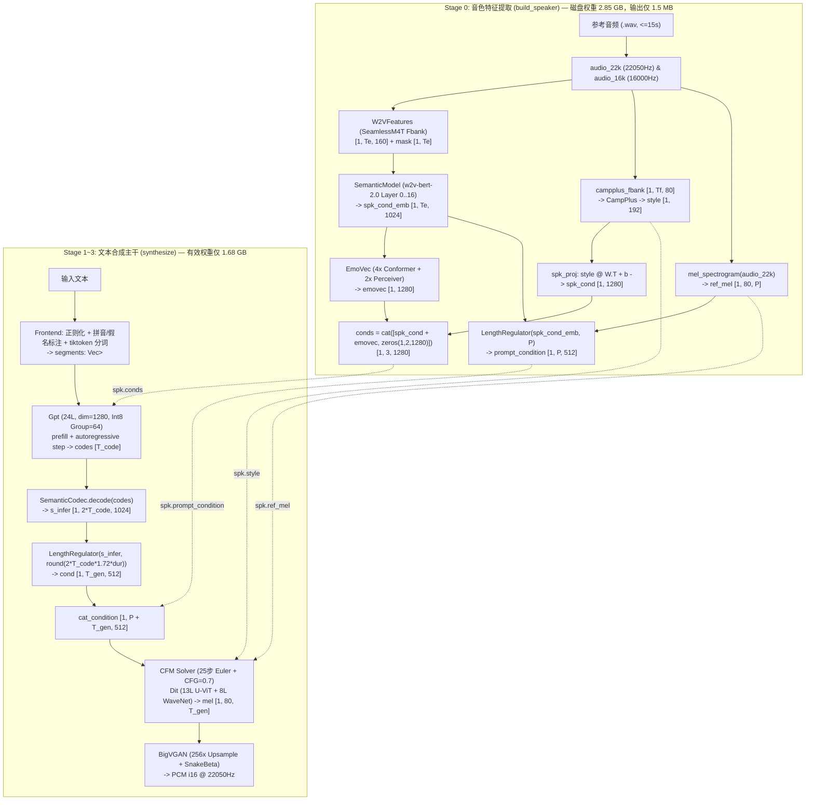

# IndexTTS-2.5-mlx 深度逆向分析与 Rust 推理架构研究报告

## 1. 研究背景与范围

本研究针对 Hugging Face 上的 [`yunfengwang/IndexTTS-2.5-mlx`](https://huggingface.co/yunfengwang/IndexTTS-2.5-mlx)（本机快照版本：`660a09b98cf667130831e73d7d49d66de1236645`）及其配套 Python 包 `index-tts-2.5-mlx`（v0.1.1，共 21 个源码文件、3,054 行代码）进行了完整的源码级与二进制张量级逆向分析。

我们的工程目标是：**在不考虑 CUDA 跨平台负担、专注于 Apple Silicon (M1/M2/M3/M4 MacBook Pro) 极致性能的前提下，使用 Rust 2024 重构一套集「高性能推理内核 Crate」与「AI Agent 专用 CLI / Daemon / MCP」于一体的生产级语音合成系统。**

---

## 2. 本机模型资产与张量结构全景盘点

本机已下载的 `IndexTTS-2.5-mlx` 权重总计 **4.73 GB**（8 个 `.safetensors` 文件、1 个 `.npz` 文件、1 个 `.tiktoken` 词表文件、2 个 `w2v-bert-2.0` JSON 配置文件）。

### 2.1 权重文件与张量审计总表

| 文件相对路径 | 磁盘体积 | 张量总数 | 数据类型分布 | 所属阶段 | 原始布局 vs MLX 布局转换规则 | 死权重（Dead Weights）审计结果 |
| :--- | :--- | :--- | :--- | :--- | :--- | :--- |
| `gpt_int8.safetensors` | 867 MB | 493 | `F32`: 396<br>`U32`: 97 | Stage 1 (T2S 解码) | 已预转换为 MLX `QuantizedLinear` (`group_size=64, bits=8`)，直接 `strict=True` 加载 | 无死权重；但 `text_embedding` (`[60510, 1280]`, 309.8MB) 与 `mel_embedding` (`[8194, 1280]`, 41.9MB) 为未量化 `F32` |
| `cfm_estimator.safetensors` | 372 MB | 230 | `F32`: 230 | Stage 2 (S2M 扩散) | 已预转换为 MLX Channels-Last：所有 `Conv1d` 权重已离线转置为 `[C_out, K, C_in]`，且 `weight_norm` 已折叠 | 无死权重 |
| `raw/semantic_codec.safetensors` | 193 MB | 241 | `F32`: 241 | Stage 2 (语义解码) | 原始 PyTorch 布局：加载时需将 3D `Conv1d` 权重从 `[out, in, K]` 转置为 `[out, K, in]` | **含 101.0 MB 死权重**：`encoder.*`、`down.*`、`*.in_project.*` 仅用于编码，推理只用 **101.3 MB** |
| `raw/length_regulator.safetensors` | 19 MB | 22 | `F32`: 22 | Stage 0 & 2 (长度规整) | 原始 PyTorch 布局：`model.{0,3,6,9,12}.weight` 需从 `[out, in, K]` 转置为 `[out, K, in]` | `embedding.weight` (`[2048, 512]`, 4.2MB) 与 `mask_token` 为离散模式死权重，推理直接丢弃 |
| `raw/bigvgan.safetensors` | 428 MB | 667 | `F32`: 667 | Stage 3 (声码器) | 原始 PyTorch 布局：`Conv1d` `[out, in, K] -> [out, K, in]`；`ups.i.0.*` (`ConvTranspose1d`) `[in, out, K] -> [out, K, in]` | 含 **218 个完全相同的 12-tap Kaiser-Sinc 滤波器张量**（`*.upsample.filter` / `*.lowpass.filter`），只需提取 1 份全局复用 |
| `raw/semantic_model.safetensors` | 2.20 GB | 775 | `F32`: 775 | Stage 0 (音色特征) | 原始 PyTorch 布局：`depthwise_conv` 等 3D 权重 `[out, in, K] -> [out, K, in]`；`_mean`/`_std` 拆出作为归一化常量 | **含 677.1 MB 死权重**：模型共 24 层 Conformer，但推理只取 `hidden_states[17]`（前 17 层，`0..=16`），第 `17..=23` 层完全不执行！ |
| `raw/emo.safetensors` | 622 MB | 153 | `F32`: 153 | Stage 0 (情感特征) | 原始 PyTorch 布局：`Conv2d` `[out, in, H, W] -> [out, H, W, in]`；`Conv1d` `[out, in, K] -> [out, K, in]`；`enc.embed.pos_enc.pe` (`[1, 5000, 512]`) 拆出为静态位置缓冲 | 无死权重，但单层 `enc.embed.out.0.weight` (`[512, 261632]`) 高达 **535.8 MB** |
| `raw/campplus.safetensors` | 27 MB | 937 | `F32`: 937 | Stage 0 (说话人编码) | 原始 PyTorch 布局：`Conv2d` `transpose(0,2,3,1)`；`Conv1d` `transpose(0,2,1)`；丢弃所有 `*.num_batches_tracked` 标量 | 无死权重；注意所有 `BatchNorm` 必须以 `eval` 模式（使用 `running_mean`/`running_var`）运行 |
| `spk_proj.npz` | 965 KB | 2 | `F32`: 2 | Stage 0 (说话人投影) | NumPy ZIP 归档：`weight [1280, 192]`, `bias [1280]` | 无 |
| `multilingual_zh_ja_yue_char_del.tiktoken` | 886 KB | 58,836 行 | Base64 + Rank | 文本前端 | 58,836 个基础 BPE Token + 1,673 个动态注册 Special Tokens（共 `60,509` 个词表项，对应 `TEXT_VOCAB = 60510`） | 无 |

---

## 3. 原版 Python `index-tts-2.5-mlx` 架构与性能瓶颈深度诊断

通过对 Python 源码的逐行剖析，我们整理出完整的数据流与 6 个核心性能瓶颈：



### 3.1 六大性能与内存瓶颈剖析

1. **瓶颈一：音色编码器（Stage 0）与合成引擎（Stage 1~3）耦合加载，白白浪费 3.05 GB 内存**
   - 原版 `engine.py::load_engines()` 在启动时无条件加载全部 8 个模型（共 **4.73 GB**），并立即调用 `mx.eval(mod.parameters())` 将其全部驻留进 Apple 统一内存。
   - 实际上，只要参考音频不变，`SpeakerContext`（仅 `conds`、`prompt_condition`、`ref_mel`、`style` 四个张量，总计约 **1.5 MB**）就是完全静态的。
   - 此外，`SemanticModel` 的第 17~23 层（**677.1 MB**）和 `SemanticCodec` 的编码器部分（**101.0 MB**）在任何推理路径下都**永远不会被调用**。
2. **瓶颈二：CFM 25 步 ODE 求解器在每一步强制同步 GPU 并往返拷贝 NumPy 数组**
   - 在 `core/cfm_solver.py` 中：
     ```python
     for step in range(1, len(t_span)):
         stacked = estimator.run(
             np.concatenate([x, x], axis=0),
             np.concatenate([prompt_x, zeros_prompt], axis=0),     # 静态不变！却在 CPU 重复拼接 25 次
             x_lens,
             np.array([t, t], dtype=np.float32),
             np.concatenate([style, zeros_style], axis=0),         # 静态不变！却在 CPU 重复拼接 25 次
             np.concatenate([cat_condition, zeros_cond], axis=0),  # 静态不变！却在 CPU 重复拼接 25 次
         )
     ```
   - 而在 `engine.py::_Cfm.run` 中：每步都把这 6 个 NumPy 数组通过 `mx.array(...)` 重新构造成 GPU Tensor，算完一步立即调 `mx.eval(v)` 阻塞等待 GPU 完成，再 `np.asarray(v)` 拷回 CPU 算 Euler 更新 `x = x + dt * ...`。这彻底摧毁了 MLX 最擅长的跨步异步流水线（Lazy Graph Evaluation）。
3. **瓶颈三：GPT 自回归解码每步执行 48 次 `mx.concatenate` 且在 CPU 端做全量 `float64` 排序采样**
   - `models/gpt.py` 第 50-51 行在每步解码时对 24 层 KV Cache 执行 `mx.concatenate([past[0], k], axis=2)`。生成一段 10 秒语音（250 步）会产生 `250 × 48 = 12,000` 次张量分配与拷贝。
   - `core/gpt_sampler.py` 每步都将 `8194` 维 Logits 同步拉回 CPU，转成 `float64`，并用 `np.argsort(logits)[::-1]` 对 8,194 个元素做 $O(N \log N)$ 全排序来计算 Top-P。
4. **瓶颈四：分段合成串行阻塞，首包延迟（TTFA）取决于整段甚至整篇文本**
   - `core/pipeline.py` 的 `for seg_ids in segments:` 循环是完全串行的，必须等所有分段的 `GPT -> Codec -> Regulator -> CFM -> BigVGAN` 全部跑完并拼接后才返回音频，不支持流式边算边播。
5. **瓶颈五：Python 生态重型依赖拖慢 CLI 启动速度**
   - 每次通过 `uvx index-tts-2.5-mlx synth` 调用时，仅 `import transformers, librosa, soundfile, tiktoken, wetext` 加模型初始化就要消耗 2~4 秒，对需要频繁发声交互的 AI Agent 极不友好。

---

## 4. Apple Silicon 推理后端选型：`mlx-rs` vs `candle` (Metal)

在不考虑 CUDA 的前提下，我们对 Rust 生态中两大 Apple Silicon 方案进行了全面评估：

### 4.1 深度技术对比

1. **`gpt_int8.safetensors` 量化格式兼容性（决定性因素）**：
   - 本机 `gpt_int8.safetensors` 中的线性层权重采用 MLX 原生 Group Affine 量化格式：
     - `weight`: `U32 [Out, In / 4]`（每 4 个 8-bit 权重打包进一个 32-bit 无符号整数）
     - `scales`: `F32 [Out, In / 64]`
     - `biases`: `F32 [Out, In / 64]`
   - **`mlx-rs` (`0.33.0`)**：内置 `mlx_rs::nn::QuantizedLinear` 与 `mlx_rs::ops::quantized_matmul`，直接调用 Apple 针对 M1~M4 GPU 调优的 SIMD-group Quantized MatMul Metal 内核，**零转换、零精度损失、满带宽运行**。
   - **`candle` (`0.9+`)**：仅支持 GGUF 风格量化（`Q8_0` 等，block size = 32，结构体内联 scale，无 affine bias）。若用 Candle，要么在加载时将其反量化回 FP16（显存带宽需求翻倍，解码速度腰斩），要么自己手写并维护一套针对 M 系列 GPU 的 Group-64 Affine Quantized MatMul Metal Shader。
2. **复杂算子与内存布局对齐**：
   - `IndexTTS-2.5-mlx` 的全部 8 个子模型均以 **Channels-Last (`[B, T, C]` / `[B, H, W, C]`)** 设计，且 `cfm_estimator.safetensors` 在磁盘上就是按 MLX `Conv1d` 的 `[C_out, K, C_in]` 存储的。
   - `LengthRegulator` 依赖 `nn.GroupNorm(1, 512, eps=1e-5, pytorch_compatible=True)`。
   - `SemanticModel` (`w2v-bert-2.0`) 依赖带 `[B, H, T, T]` 相对位置偏置矩阵的 `mx.fast.scaled_dot_product_attention`。
   - 以上算子在 **`mlx-rs`** 中全部现成可用；而在 **`candle-metal`** 中多处需要手写 Custom Op 或存在回退 CPU 的风险。
3. **Lazy Graph vs Eager Dispatch**：
   - `mlx-rs` 的惰性求值图允许我们将 CFM 的多步 Euler 更新、BigVGAN 的 `Upsample2x -> SnakeBeta -> Downsample2x` 组合成大图异步提交给 GPU，大幅降低 Metal Command Buffer 调度开销。

**选型结论**：坚定选择 **`mlx-rs` (`0.33.0`)** 作为底层张量与神经网络引擎。

---

## 5. Rust 2024 核心依赖栈调研（2026 最新稳定版）

为遵循 [AGENTS.md](../../AGENTS.md) 规范（纯 Rust 优先、最小化依赖、最新稳定版），选定以下依赖矩阵：

| 领域 | Crate 名称 | 最新版本 | 选型理由与用途 |
| :--- | :--- | :--- | :--- |
| **GPU 推理核心** | `mlx-rs` | `0.33.0` | Apple MLX 官方 C/C++ 核心的 Rust 绑定，支持 `metal`、`safetensors`、`quantized_matmul` 与 `fast::scaled_dot_product_attention` |
| **权重安全加载** | `safetensors` / `memmap2` | `0.8.0` / `0.9` | 解析 `.safetensors` Header、实现死权重按需过滤、以及自定义 `.itts_voice` 音色快照格式序列化 |
| **语法与标注解析** | `winnow` | `1.0.4` | 零拷贝解析 `<word\|PRON>` 多音字/假名标注、`<\|SPECIAL_TOKEN\|>` 切分、以及 `.tiktoken` 词表文件 |
| **音频解码与封装** | `symphonia` / `hound` | `0.6.1` / `3.5.1` | 纯 Rust 解码任意采样率 WAV/MP3/FLAC 参考音频，以及高性能生成 22.05kHz WAV 文件 |
| **数字信号处理 (DSP)** | `realfft` / `rustfft` | `3.5.1` / `6.4.1` | 纯 Rust 实现 `mel_spectrogram` (1024-pt RFFT) 与 Kaldi Fbank (512-pt RFFT)，彻底替代 `librosa` 与 `kaldi-native-fbank` |
| **低延迟音频播放** | `cpal` | `0.18.2` | 跨平台/macOS CoreAudio 原生低延迟音频输出流，支撑 `--play` 边合成边播放 |
| **并发与 Actor 通道** | `tokio` / `flume` | `1.52` / `0.12.0` | 异步运行时与高性能 MPMC/MPSC 通道，驱动「文本前端 -> GPT T2S -> CFM+BigVGAN」三级流水线 Actor |
| **无锁并发状态** | `dashmap` / `arc-swap` | `6.1` / `1.9.3` | 内存音色缓存池（`DashMap<VoiceId, Arc<SpeakerContext>>`）与运行时热更新配置（`ArcSwap<EngineConfig>`） |
| **类型安全与校验** | `typed-builder` / `validator` | `0.23.2` / `0.21.0` | 多参数结构体编译期 Builder 与外部输入（CLI/HTTP/MCP）边界校验 |
| **配置与 CLI** | `config` / `clap` | `0.15.27` / `4.6.7` | YAML 配置文件加载与 CLI 子命令解析 |
| **模型下载与 MCP** | `hf-hub` / `rmcp` | `1.0.0` / `3.8.0` | 自动从 Hugging Face Hub 拉取模型快照；提供标准 MCP (Model Context Protocol) Server 供 Agent 挂载 |
