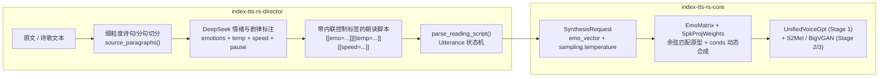

# IndexTTS-2.5 情绪向量推理与细粒度朗读导演架构设计 (`indextts-emotion-director-design`)

- **状态**: 已批准 (Approved)
- **版本**: 1.0
- **关联组件**: `index-tts-rs-core`, `index-tts-rs-director`, `itts` (CLI / Daemon / MCP), `itts-server` (HTTP / Web Studio)

---

## 1. 背景与问题定义

在朗读抒情现代诗（如徐志摩《再别康桥》）或情感色彩丰富的散文时，仅调整语速（`[[speed=...]]`）与停顿（`[[pause=...]]`）无法改变模型在声学潜空间中的情感底色与抑扬顿挫，导致合成出的语音平淡、缺乏感染力。

上游 `IndexTeam/IndexTTS-2.5`（见 `indextts/infer_v2_5.py`）具备原生的 **8 类情绪强度向量控制（`emo_vector`）** 与 **GPT 采样温度（`temperature`）** 调节机制，但 `yunfengwang/IndexTTS-2.5-mlx` 与当前 Rust 引擎尚未移植 `emo_vector` 条件混合管线。此外，`index-tts-rs-director` 的诗歌分段原先仅按空行切分整节（Stanza），无法在同一诗节内部的转折句（如分号 `；`、句号 `。`、感叹号 `！`、问号 `？` 处）切换情绪与语气。

本设计规范定义从底层 MLX 情绪向量条件混合、内联控制标签（`[[emo=...]]` 与 `[[temp=...]]`）、到 DeepSeek 细粒度诗歌/散文情绪标注与全端接口暴露的完整架构。

---

## 2. 上游 IndexTTS-2.5 情绪矩阵数学规格

### 2.1 八类情绪顺序与原型矩阵

上游 `IndexTeam/IndexTTS-2.5` 定义固定顺序的 8 类基础情绪（共 73 个情绪-说话人原型行）：

| 索引 $c$ | 英文标识 | 中文标识 / 别名 | 原型行数 `emo_num[c]` | 行区间 (`0..73`) | 偏置系数 `emo_bias[c]` |
|---:|---|---|---:|---|---:|
| 0 | `happy` | `高兴`, `快乐`, `喜悦` | 3 | `0..3` | `0.9375` (`15/16`) |
| 1 | `angry` | `愤怒`, `生气`, `恼怒` | 17 | `3..20` | `0.8750` (`7/8`) |
| 2 | `sad` | `悲伤`, `伤心`, `哀伤` | 2 | `20..22` | `1.0000` (`1`) |
| 3 | `afraid` | `恐惧`, `害怕`, `惊恐` | 8 | `22..30` | `1.0000` (`1`) |
| 4 | `disgusted` | `反感`, `厌恶`, `嫌弃` | 4 | `30..34` | `0.9375` (`15/16`) |
| 5 | `melancholic` | `低落`, `忧郁`, `惆怅`, `感伤` | 5 | `34..39` | `0.9375` (`15/16`) |
| 6 | `surprised` | `惊讶`, `惊奇`, `诧异` | 10 | `39..49` | `0.6875` (`11/16`) |
| 7 | `calm` | `平静`, `自然`, `温和`, `宁静` | 24 | `49..73` | `0.5625` (`9/16`) |

两个核心原型矩阵来自 `IndexTeam/IndexTTS-2.5` 的 `feat1.pt` 与 `feat2.pt`，转换并内置为 `crates/core/assets/emo_matrix.safetensors`（总计约 430 KB，同时支持从 `model_dir/emo_matrix.safetensors` 覆盖加载）：

- `spk_matrix`: `[73, 192]` (`F32`) — 73 个情绪原型的 `CAMPPlus` 说话人风格向量。
- `emo_matrix`: `[73, 1280]` (`F32`) — 73 个情绪原型的 `emo_layer` 投影后情绪条件向量。

### 2.2 情绪向量归一化 (`normalize_emo_vec`)

给定用户或 AI 导演指定的 8 维非负权重 $\mathbf{w}_{\text{raw}} = [w_0, \dots, w_7] \in [0, 1]^8$ 及全局情绪强度缩放因子 $\alpha \in [0, 1]$（`emo_alpha`）：

1. **偏置校正**：对每个分量乘以经验偏置抑制过强基底：
   $$w'_c = w_c \cdot \text{emo\_bias}[c]$$
2. **总和上限约束（`<= 0.8`）**：为保证目标音色特征不被情绪向量完全淹没，若 $\sum_{c=0}^7 w'_c > 0.8$，按比例缩放使总和恰好为 `0.8`：
   $$w''_c = \begin{cases} w'_c \cdot \dfrac{0.8}{\sum_{k=0}^7 w'_k} & \text{if } \sum_{k=0}^7 w'_k > 0.8 \\ w'_c & \text{otherwise} \end{cases}$$
3. **全局 Alpha 缩放**：
   $$\hat{w}_c = \alpha \cdot w''_c$$

### 2.3 基于音色相似度的原型检索与 `conds` 动态合成

在 `IndexTTS-2.5` 中，GPT 的前缀条件 `conds` 形状为 `[1, 3, 1280]`，其中仅第 0 帧包含有效条件向量，第 1、2 帧全为 `0.0`：

$$\text{conds}[0, 0, :] = \mathbf{s}_{\text{spk}} + \mathbf{e}_{\text{final}}, \quad \text{conds}[0, 1..3, :] = \mathbf{0}$$

其中：
- $\mathbf{s}_{\text{spk}} = \text{spk\_proj}(\text{style}) \in \mathbb{R}^{1280}$ 是由说话人 `[192]` 维 `style` 向量经线性层 `spk_proj`（`[1280, 192]` 权重 + `[1280]` 偏置）投影得到的说话人条件向量。
- $\mathbf{e}_{\text{base}} \in \mathbb{R}^{1280}$ 是参考音频自身携带的基底情绪向量。

#### 零 Stage-0 开销的 `.itts_voice` 动态情绪合成
`.itts_voice` 快照文件已持久化保存了 `style` (`[192]`)、`conds` (`[3 * 1280]`) 以及创建快照时的 `metadata.emo_alpha` ($\alpha_0$)。
由于创建快照时：
$$\text{conds}[0..1280] = \mathbf{s}_{\text{spk}} + \alpha_0 \cdot \mathbf{e}_{\text{base}}$$
推理工作线程只需在启动时加载轻量级的 `spk_proj.npz`（965 KB）与 `emo_matrix.safetensors`（430 KB），无需加载 2.85 GB 的 Stage-0 编码器（W2V-BERT / CAMPPlus / S2Mel），即可在微秒级时间内：

1. 由 `spk_proj.project(&spk.style)` 精确计算出 $\mathbf{s}_{\text{spk}} \in \mathbb{R}^{1280}$。
2. 恢复参考音频基底情绪向量：
   $$\mathbf{e}_{\text{base}} = \begin{cases} \dfrac{\text{conds}[0..1280] - \mathbf{s}_{\text{spk}}}{\alpha_0} & \text{if } \alpha_0 \ge 10^{-4} \\ \mathbf{0} & \text{otherwise} \end{cases}$$
3. 对每个权重 $\hat{w}_c > 0$ 的情绪类别 $c \in 0..8$，在该类别对应的 `spk_matrix` 子切片中选择与当前音色 `style` (`[192]`) **余弦相似度最高** 的原型行 $r^*_c$：
   $$r^*_c = \arg\max_{r \in \text{slice}(c)} \frac{\langle \text{style}, \text{spk\_matrix}[r] \rangle}{\|\text{style}\|_2 \cdot \|\text{spk\_matrix}[r]\|_2}$$
4. 混合目标情绪向量与基底情绪向量：
   $$\mathbf{e}_{\text{final}} = \sum_{c=0}^{7} \hat{w}_c \cdot \text{emo\_matrix}[r^*_c] + \left(1.0 - \sum_{c=0}^{7} \hat{w}_c\right) \mathbf{e}_{\text{base}}$$
5. 组装新的 `[1, 3, 1280]` 条件张量：第 0 帧为 $\mathbf{s}_{\text{spk}} + \mathbf{e}_{\text{final}}$，第 1、2 帧为 `0.0`。

---

## 3. 核心架构与类型设计



### 3.1 `EmotionVector` 领域原语 (`crates/core/src/config.rs`)

定义强类型 `EmotionVector`：

```rust
#[derive(Debug, Clone, Copy, PartialEq, Default, Serialize, Deserialize)]
#[serde(rename_all = "camelCase", deny_unknown_fields)]
pub struct EmotionVector {
    #[serde(default)]
    pub happy: f32,
    #[serde(default)]
    pub angry: f32,
    #[serde(default)]
    pub sad: f32,
    #[serde(default)]
    pub afraid: f32,
    #[serde(default)]
    pub disgusted: f32,
    #[serde(default)]
    pub melancholic: f32,
    #[serde(default)]
    pub surprised: f32,
    #[serde(default)]
    pub calm: f32,
}
```

- **解析规范 (`FromStr` / `parse_spec`)**：
  - 支持键值列表（逗号、`、` 或空格分隔）：`melancholic:0.45,calm:0.25` 或中文 `低落:0.45,平静:0.25`。
  - 支持单一情绪简写（省略权重时默认为 `0.6`）：`[[emo=melancholic]]` 等价于 `melancholic:0.6`；`[[emo=calm]]` 等价于 `calm:0.6`。
  - 支持重置/清空情绪覆盖：`none`、`default`、`reset`、`无`、`默认`。
  - 支持 8 维位置数组简写：`0,0,0.4,0,0,0.3,0,0.1`（8 个逗号分隔的浮点数）。
  - 边界校验：每个分量必须为有限浮点数且在 `0.0..=1.0` 之间；未知情绪名称直接返回 `TtsError::Validation`（遵循 Reject, don't sanitize 原则）。
- **格式化规范 (`format_compact`)**：
  - 按固定顺序输出非零（`> 0.005`）分量，如 `melancholic:0.45,calm:0.25`，全零时返回 `none`。

### 3.2 内联控制标签扩展 (`crates/director/src/controls.rs`)

在保持既有标签（`[[speed=...]]`、`[[pause=...]]`、`[[voice=...]]`、`[[lang=...]]`、`[[reset]]`）完全向后兼容的基础上，新增两个有状态控制标签：

1. **`[[emo=...]]`**：
   - 设置当前朗读状态的情绪向量 `Option<EmotionVector>`。
   - 示例：
     - `[[emo=melancholic:0.45,calm:0.25]]` 或 `[[emo=低落:0.45,平静:0.25]]`
     - `[[emo=happy:0.5,surprised:0.2]]`
     - `[[emo=calm]]`（单情绪默认权重 `0.6`）
     - `[[emo=none]]`（恢复参考音频自带的默认情绪）
2. **`[[temp=...]]` / `[[temperature=...]]`**：
   - 设置当前朗读状态的 GPT 采样温度 `SamplingConfig.temperature`（范围 `0.05..=2.0`）。
   - 物理意义：较低温度（`0.65..=0.75`）使语调克制、平稳、内敛；较高温度（`0.82..=0.95`）增强抑扬顿挫与情感张力。
3. **`[[reset]]`**：
   - 将 `voice`、`lang`、`speed`、`emo_vector`、`sampling.temperature` 全部恢复为 `ReadingDefaults` 的初始值。

### 3.3 细粒度诗歌分句与 DeepSeek 情绪导演 (`crates/director/src/annotation.rs`)

#### 细粒度诗歌分句 (`source_paragraphs(text, poetry)`)
- 当 `poetry == false` 时，保持按空行分段。
- 当 `poetry == true` 时，不仅识别空行（诗节边界），还将每个诗节内部按强句读边界（分号 `;` / `；`、句号 `.` / `。`、感叹号 `!` / `！`、问号 `?` / `？` 及其紧随的引号/括号）切分为 **诗句联（Couplet / Sentence Unit）**，并记录每个单元之后是「节内停顿（Intra-stanza）」还是「跨节停顿（Inter-stanza）」。
- 以《再别康桥》为例，每一节 4 行诗通常由第 2 行末尾的分号/句号/感叹号自然分为上下两联（每联 2 行）。切分后全诗 7 节变为 14 个细粒度情感单元，使节内的情绪转折（如「悄悄是别离的笙箫；」→「夏虫也为我沉默，沉默是今晚的康桥！」）能够获得独立的情绪向量、采样温度、语速与停顿。

#### DeepSeek 标注 JSON Schema
DeepSeek 仅返回按索引对齐的数值与情绪参数，**绝不输出或改写正文**：

```json
{
  "segments": [
    {
      "index": 0,
      "speed": 0.88,
      "temperature": 0.74,
      "pauseAfterMs": 450,
      "emotions": {
        "melancholic": 0.35,
        "calm": 0.35
      }
    }
  ]
}
```

- **校验规则**：
  - `index`: 必须严格等于 `0..segments.len()`。
  - `speed`: 有限浮点数，校验范围 `0.5..=2.0`（提示词引导 `0.80..=1.20`）。
  - `temperature`: 可选有限浮点数，校验范围 `0.5..=1.2`（提示词引导：平缓克制 `0.68..=0.76`，常规叙事 `0.78..=0.82`，激昂/感叹 `0.84..=0.92`）。
  - `pauseAfterMs`: `0..=5000` 毫秒。
  - `emotions`: 可选的 8 类情绪键值映射（分量范围 `0.0..=1.0`）。
- **脚本渲染 (`render_annotation`)**：
  - 若 `emotions` 非空，生成 `[[emo=...]]`（当上一段有情绪而当前段无情绪时生成 `[[emo=none]]`）。
  - 若 `temperature` 存在且与默认值（`0.8`）偏差超过 `0.01`，生成 `[[temp=...]]`。
  - 始终生成 `[[speed=...]]`，并在段落间插入 `[[pause=...]]`；节内联间使用单换行保持同节视觉紧凑，跨诗节使用双换行保留原诗节结构。

---

## 4. 全端接口暴露规格

1. **CLI (`itts`)**：
   - `itts synth` 新增 `--emo <SPEC>`（如 `--emo melancholic:0.45,calm:0.25` 或 `--emo 低落:0.45,平静:0.25`）。
   - `itts voice add` 新增 `--emo <SPEC>`，支持在制作 `.itts_voice` 快照时直接烘焙指定情绪向量。
2. **Daemon (`apps/cli/src/daemon.rs`)**：
   - `SynthesisRequest` 包含 `emo_vector: Option<EmotionVector>`，通过 Unix Domain Socket JSONL 协议透明传输并在驻留引擎中动态合成 `conds`。
3. **MCP Server (`apps/cli/src/mcp.rs`)**：
   - `synthesize` 与 `extract_voice` 工具 Schema 新增可选 `emo` 字符串参数，描述 8 类情绪向量语法与内联 `[[emo=...]]` / `[[temp=...]]` 标签。
4. **HTTP Server & Web Studio (`apps/server`)**：
   - `/v1/audio/speech` 与 `/api/speech/stream` 请求体新增可选 `emo: Option<String>` 字段作为默认情绪向量。
   - `/api/annotate` 自动输出包含 `[[emo=...]]`、`[[temp=...]]`、`[[speed=...]]`、`[[pause=...]]` 的完整导演脚本。
   - Web Studio (`index.html` / `app.js`) 更新手工控制标签说明与生成结果摘要（显示情绪、语调温度、语速状态）。

---

## 5. 验证与测试计划

1. **资产与数值验证**：
   - 验证 `crates/core/assets/emo_matrix.safetensors` 中 `spk_matrix` (`[73, 192]`) 与 `emo_matrix` (`[73, 1280]`) 的张量形状、数值有限性，以及与上游 `feat1.pt` / `feat2.pt` 的精确一致。
   - 单元测试验证 `EmotionVector::normalize` 的 `emo_bias` 乘法、`0.8` 总和上限缩放与 `emo_alpha` 缩放。
   - 单元测试验证 `SpeakerContext::resolve_conds_with_emotion`：当 `emo_vector` 全为 `0` 时，还原出的 `conds[0..1280]` 与原始快照误差 `< 1e-4`；当注入非零情绪时，输出的第 0 帧有限且第 1、2 帧严格为 `0.0`。
2. **控制标签与诗歌切分测试**：
   - 测试 `[[emo=...]]`（中英文名、单情绪简写、`none` 重置）与 `[[temp=...]]` 状态流转及 `[[reset]]` 行为。
   - 测试《再别康桥》多节诗歌在 `poetry = true` 下的细粒度联级切分与 `render_annotation` 原文零篡改不变量。
3. **全量门禁**：
   - 通过 `cargo build`、`cargo test`、`cargo +nightly fmt -- --check`、`cargo clippy -- -D warnings`。
