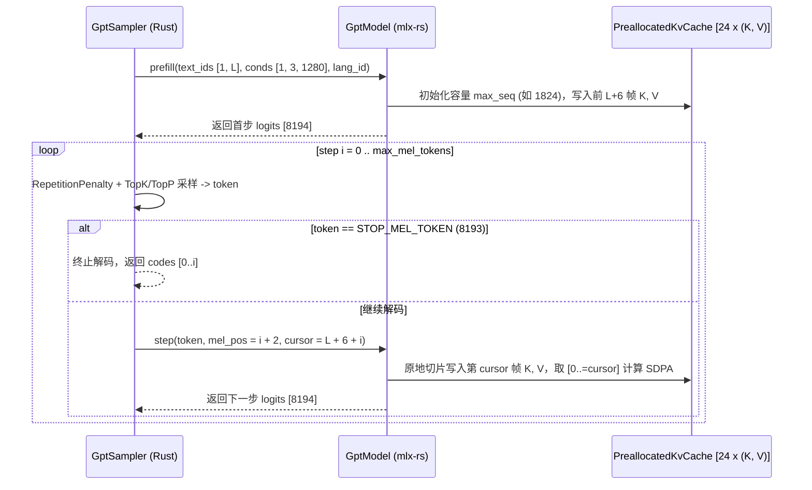
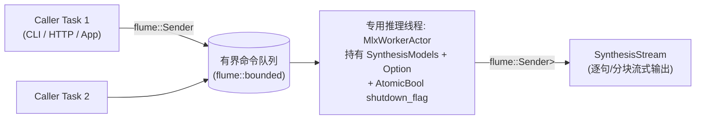

# IndexTTS-2.5 Rust 高性能推理引擎与 Agent CLI 详细架构设计 (`indextts-rust-engine-design`)

## 1. 概述与设计原则

本文档是 [`indextts-rust-prd`](./indextts-rust-prd.md) 的配套详细技术设计规范（Design Spec），基于对本机 `yunfengwang/IndexTTS-2.5-mlx` 模型快照与 Python 参考源码的完整逆向工程（详见 [`docs/research/indextts-2.5-mlx-architecture-and-backend-research.md`](../docs/research/indextts-2.5-mlx-architecture-and-backend-research.md)）编写。

核心工程准则（严格对齐 [AGENTS.md](../AGENTS.md)）：
- **Rust 2024 Edition**，所有 Workspace Crate 启用 `#![forbid(unsafe_code)]` 与 `#![warn(rust_2024_compatibility, missing_docs, missing_debug_implementations)]`。
- **Actor + Channel 并发模型**：由于 `mlx_rs::Array` 与 GPU 设备流并非 `Send + Sync` 的自由共享对象，所有 MLX 模型实例严格封装在专属的推理 Worker 线程内，外部调用方通过 `flume` 有界通道与 Actor 异步交互。
- **两阶段物理隔离**：将「音色编码阶段（Stage 0）」与「语音合成阶段（Stage 1~3）」彻底解耦，通过 `.itts_voice`（SafeTensors 格式）持久化 `SpeakerContext`，将常驻内存从 4.8 GB 压降至 **1.68 GB**。
- **全 GPU 驻留循环**：消除 Python 版在 GPT 解码与 CFM 25 步 ODE 求解中的 CPU/NumPy 往返拷贝与动态张量重分配。

---

## 2. Workspace 与模块分层架构

```text
index-tts-rs/
├── Cargo.toml                  # Workspace 根配置 (resolver = "3", edition = "2024")
├── config/
│   └── default.yaml            # 默认运行时可调超参数与路径配置
├── crates/
│   └── core/                   # (index-tts-rs-core) 核心库 Crate
│       └── src/
│           ├── lib.rs          # 对外暴露的高层 API (IndexTtsEngine, SpeakerPrompt, SynthesisRequest)
│           ├── config.rs       # 基于 `config` + `serde` + `validator` 的 YAML 配置与 Newtypes
│           ├── error.rs        # 基于 `thiserror` 的领域错误枚举 IndexTtsError
│           ├── dsp/            # 纯 Rust 信号处理
│           │   ├── audio.rs    # symphonia 解码、hound WAV 编码、15s 截断
│           │   ├── resample.rs # 精确复刻 torchaudio sinc_interp_hann 与高质量重采样
│           │   ├── mel.rs      # 22.05kHz Slaney Mel Spectrogram (n_fft=1024, hop=256, mels=80)
│           │   └── fbank.rs    # 16kHz Kaldi Povey Fbank (campplus_fbank & SeamlessM4T w2v_features)
│           ├── frontend/       # 纯 Rust 多语种文本前端
│           │   ├── parser.rs   # 基于 `winnow` 的 <word|PRON> 注音语法与 <|SPECIAL|> 切分器
│           │   ├── normalizer.rs # 术语词典 (glossary.yaml)、标点映射、人名/拼音/数字规范化
│           │   ├── tokenizer.rs  # multilingual_zh_ja_yue_char_del.tiktoken BPE 分词器
│           │   └── splitter.rs   # 基于 Token 预算 (max_text_tokens_per_segment=120) 的智能分句器
│           ├── models/         # 基于 `mlx-rs` 的 8 大神经网络算子实现与死权重裁剪加载器
│           │   ├── loader.rs   # SafeTensors 过滤加载、Conv 权重转置、spk_proj.npz 解析
│           │   ├── semantic.rs # Stage 0: w2v-bert-2.0 (仅加载前 17 层，省 677MB)
│           │   ├── emo.rs      # Stage 0: EmoVec (4L Conformer + 2L PerceiverResampler)
│           │   ├── campplus.rs # Stage 0: CAMPPlus (FCM Conv2d + DenseTDNN)
│           │   ├── gpt.rs      # Stage 1: Gpt2Core (24L Int8 Group=64 + 预分配 In-Place KV Cache)
│           │   ├── sampler.rs  # Stage 1: RepetitionPenalty + Temp + TopK + TopP 采样器
│           │   ├── codec.rs    # Stage 2: SemanticCodec.decode (省 101MB 编码端死权重)
│           │   ├── regulator.rs# Stage 0 & 2: LengthRegulator (InterpolateRegulator)
│           │   ├── cfm.rs      # Stage 2: Dit (13L U-ViT + 8L WaveNet) + 全 GPU Euler ODE Solver
│           │   └── bigvgan.rs  # Stage 3: BigVGAN (256x 相位分解上采样 + 抗混叠 SnakeBeta)
│           ├── voice/          # 音色上下文与 `.itts_voice` 快照管理
│           │   ├── context.rs  # SpeakerContext 结构体与 `.itts_voice` SafeTensors 序列化
│           │   └── store.rs    # DashMap 内存音色缓存池 + 磁盘音色库管理
│           └── engine/         # Actor 并发调度与流式合成管线
│               ├── actor.rs    # MLX 专属推理线程 Actor (支持优雅启动/停止/重启与 AtomicBool 信号)
│               └── stream.rs   # 句子级流式 AudioChunk 生成器与句间静音/交叉淡入淡出
└── apps/
    ├── cli/                    # (index-tts) 面向 AI Agent 与开发者的全功能 CLI
    │   └── src/
    │       ├── main.rs         # clap 命令行入口
    │       ├── commands/       # synth, voice, models, daemon, mcp 子命令实现
    │       ├── daemon.rs       # Unix Domain Socket 常驻守护进程与客户端自动转发
    │       ├── mcp.rs          # 基于 `rmcp` 的 Model Context Protocol (stdio) Server
    │       └── player.rs       # 基于 `cpal` 的 macOS CoreAudio 流式播放器
    └── server/                 # (index-tts-server) HTTP / WebSocket / OpenAI 兼容语音服务
```

---

## 3. 核心数据结构与类型安全边界设计

遵循 [AGENTS.md](../AGENTS.md) 的 Input Validation 与 Type Design 规范，所有外部输入在边界处立即校验并封装为 Newtype：

### 3.1 领域原语与校验 (Newtypes & Validation)

```rust
use std::num::{NonZeroU32, NonZeroUsize};
use serde::{Deserialize, Serialize};
use typed_builder::TypedBuilder;
use validator::Validate;

/// 受限合成文本（按字节限制最大长度 16KB，拒绝空字符串与 NUL 字节）
#[derive(Debug, Clone, PartialEq, Eq, Serialize, Deserialize)]
pub struct SynthesisText(String);

/// 受限音色标识符（仅允许 `^[a-zA-Z0-9_-]{1,64}$`，防止路径穿越）
#[derive(Debug, Clone, PartialEq, Eq, Hash, Serialize, Deserialize)]
pub struct VoiceId(String);

/// 支持的语种枚举
#[derive(Debug, Clone, Copy, PartialEq, Eq, Default, Serialize, Deserialize)]
#[serde(rename_all = "lowercase")]
#[non_exhaustive]
pub enum Language {
    #[default]
    Zh,
    En,
    Ja,
    Yue,
    Es,
    Ar,
    #[serde(rename = "zh/en", alias = "zhen")]
    ZhEn,
    Common,
}

impl Language {
    /// 对应 frontend.py 中的 LANGUAGE_DICT 索引与特殊 Token 前缀
    pub const fn token_id(self) -> i32 {
        match self {
            Self::En => 0,
            Self::Zh => 1,
            Self::Es => 3,
            Self::Ja => 7,
            Self::Ar => 13,
            Self::Yue => 87,
            Self::ZhEn => 91,
            Self::Common => 93,
        }
    }
}
```

### 3.2 `.itts_voice` 音色快照格式规范

`SpeakerContext` 是连接 Stage 0 与 Stage 1~3 的唯一桥梁。在内存中表示为：

```rust
/// 预计算的说话人音色与情感条件特征（总体积 ~1.5 MB）
#[derive(Debug, Clone)]
#[non_exhaustive]
pub struct SpeakerContext {
    /// GPT 条件前缀张量: shape `[1, 3, 1280]`, dtype `f32`
    /// 第 0 帧为 `spk_cond + emo_alpha * emovec`，第 1..2 帧为全 0
    pub conds: Vec<f32>,
    /// CFM 提示条件张量: shape `[1, P, 512]`, dtype `f32`
    pub prompt_condition: Vec<f32>,
    /// 参考音频 Mel 频谱: shape `[1, 80, P]`, dtype `f32`
    pub ref_mel: Vec<f32>,
    /// CAMPPlus 说话人风格向量: shape `[1, 192]`, dtype `f32`
    pub style: Vec<f32>,
    /// 参考音频 Mel 帧数 `P`
    pub prompt_frames: NonZeroUsize,
}
```

当持久化为 `<voice_id>.itts_voice` 时，直接采用标准 **SafeTensors** 二进制格式存储上述 4 个张量（键名分别为 `"conds"`, `"prompt_condition"`, `"ref_mel"`, `"style"`），并在 SafeTensors Header 的 `__metadata__` 中写入：
- `"format_version": "1"`
- `"model_id": "yunfengwang/IndexTTS-2.5-mlx"`
- `"source_audio_blake3": "<hex>"`
- `"emo_alpha": "1.0"`

---

## 4. 纯 Rust DSP 与文本前端精确设计

### 4.1 纯 Rust DSP 四大算子 (`crates/core/src/dsp/`)

为彻底移除 Python `librosa`、`torchaudio`、`kaldi-native-fbank` 和 `transformers.SeamlessM4TFeatureExtractor`，在 Rust 中实现 100% 数值对齐的 4 个函数：

1. **`resample_sinc_hann(y: &[f32], orig_freq: u32, new_freq: u32) -> Vec<f32>`**
   - 精确复刻 `core/dsp.py::resample_sinc_hann`：
     - $g = \gcd(\text{orig}, \text{new})$，$f_{\text{orig}} = \text{orig}/g, f_{\text{new}} = \text{new}/g$
     - $\text{base\_freq} = \min(f_{\text{orig}}, f_{\text{new}}) \times 0.99$，$\text{width} = \lceil 6 \times f_{\text{orig}} / \text{base\_freq} \rceil$
     - 使用 `f64` 计算窗宽与 $\cos^2$ Hann 窗调制的 $\text{sinc}$ 滤波器核矩阵 `[f_new, 2 * width + f_orig]`，随后转为 `f32` 对两侧补零后的输入信号做步长 `f_orig` 的矩阵乘。
2. **`mel_spectrogram(audio_22k: &[f32]) -> Array3<f32>` (`[1, 80, P]`)**
   - 参数：`n_fft = 1024, win_size = 1024, hop_size = 256, num_mels = 80, sr = 22050, fmin = 0.0, fmax = 11025.0`。
   - 对输入两侧做 `pad = (1024 - 256) / 2 = 384` 的 `reflect` 镜像填充。
   - 乘周期性 Hann 窗 $0.5 - 0.5\cos(2\pi n / 1024)$，通过 `realfft` 执行 1024 点实数 FFT，计算功率幅度 $\sqrt{\text{re}^2 + \text{im}^2 + 10^{-9}}$。
   - 乘 `librosa` Slaney 归一化 Mel 滤波器组 `[80, 513]`，最后取 $\ln(\max(x, 10^{-5}))$。
3. **`kaldi_fbank(audio_16k: &[f32], scale_int16: bool) -> Array2<f32>` (`[T, 80]`)**
   - 统一支撑 `campplus_fbank`（`scale_int16 = false`）与 `w2v_features`（`scale_int16 = true`，即先乘 `32768.0`）：
   - 帧长 `400`（25ms @ 16kHz），帧移 `160`（10ms @ 16kHz），`snip_edges = true`（帧数 $M = 1 + \lfloor (N - 400) / 160 \rfloor$）。
   - 每帧内部处理顺序（严格遵循 Kaldi `ExtractWindow`）：
     1. **移除直流偏置（Remove DC Offset）**：每帧减去该帧 400 个采样点的均值；
     2. **预加重（Preemphasis `0.97`）**：$s'[n] = s[n] - 0.97 \cdot s[n-1]$（对于 $n=0$，$s'[0] = s[0] \cdot (1 - 0.97) = 0.03 \cdot s[0]$）；
     3. **乘 Povey 窗**：$w[n] = (0.5 - 0.5\cos(2\pi n / 399))^{0.85}$；
     4. **512 点 RFFT 功率谱**：末尾补零至 512 点，取功率谱 $\text{re}^2 + \text{im}^2$，乘 Kaldi Mel 滤波器组（$f_{\text{low}}=20\text{ Hz}, f_{\text{high}}=8000\text{ Hz}$，Mel 刻度 $1127 \ln(1 + f/700)$），取 $\ln(\max(E, \text{epsilon}))$。
4. **`campplus_fbank` 与 `w2v_features` 后处理**：
   - `campplus_fbank`：`kaldi_fbank(audio_16k, false)` 后减去时间维均值 `feat - mean(feat, axis=0)`，输出 `[1, T, 80]`。
   - `w2v_features`：`kaldi_fbank(audio_16k, true)` 后按通道做均值与无偏方差归一化 $(x - \mu) / \sqrt{\sigma_{\text{ddof}=1}^2 + 10^{-7}}$；若帧数 $T$ 为奇数则在末尾补一帧全 `1.0`（对应 `padding_value = 1`），最后将相邻两帧拼接 reshape 为 `[1, T_even / 2, 160]`，掩码为 `[1, T_even / 2]`。

### 4.2 纯 Rust 文本前端与分词器 (`crates/core/src/frontend/`)

1. **发音覆盖与特殊 Token 解析器（基于 `winnow`）**：
   - 使用 `winnow` 组合子扫描 `<word|pronunciation>` 语法，替代脆弱的正则回溯。
   - 规则：
     - 若 `pronunciation` 全为平假名（`\u{3040}..\u{309F}`）或片假名（`\u{30A0}..\u{30FF}`），替换为 `" {PRON} "`；
     - 若 `word` 含中日韩统一表意文字（`\u{4E00}..\u{9FFF}`），替换为 `"<|SPECIAL_TOKEN_2|>{PRON}<|SPECIAL_TOKEN_2|>"`；
     - 否则替换为 `"<|SPECIAL_TOKEN_1|>{PRON}<|SPECIAL_TOKEN_1|>"`。
2. **Tiktoken BPE 编码器**：
   - 启动时读取 `multilingual_zh_ja_yue_char_del.tiktoken` 的 58,836 行，使用 `base64` 解码得到字节序列到 `rank: u32` 的 `HashMap<Vec<u8>, u32>`。
   - 按 `core/frontend.py::get_encoding` 完全一致的顺序注册 1,673 个特殊 Token（ID `58836..=60508`）。
   - 执行字节级 BPE Merge 后，过滤掉任何 `token_id <= 1` 的值（防止字面量 `!` 等触发 `0` 号 `START_TEXT_TOKEN`）。

---

## 5. `mlx-rs` 神经网络模型层与优化设计 (`crates/core/src/models/`)

### 5.1 权重加载与死权重裁剪器 (`models::loader`)

所有模型加载统一经过 `SafeTensorsLoader`：
1. **死权重黑名单过滤（解析 Header 阶段即跳过，零内存分配）**：
   - `semantic_model.safetensors`：跳过 `masked_spec_embed` 及所有前缀为 `encoder.layers.{17..=23}.` 的张量（节省 **677.1 MB**）。
   - `semantic_codec.safetensors`：跳过所有前缀为 `encoder.`、`down.` 或包含 `.in_project.` 的张量（节省 **101.0 MB**）。
   - `length_regulator.safetensors`：跳过 `embedding.weight` 与 `mask_token`。
   - `campplus.safetensors`：跳过所有后缀为 `num_batches_tracked` 的张量。
   - `bigvgan.safetensors`：拦截所有后缀为 `.upsample.filter` 与 `.lowpass.filter` 的 218 个重复张量，仅保留第 1 个（`[12]` float32 Kaiser-Sinc 滤波器）用于构造全局深度可分离卷积核。
2. **PyTorch -> MLX 张量维度自动转置规则**：
   - 对于已预转换的 `gpt_int8.safetensors` 和 `cfm_estimator.safetensors`：直接原样映射。
   - 对于 `raw/*.safetensors` 中的原始 PyTorch 权重：
     - 普通 3D `Conv1d` 权重 `[Out, In, K]` $\xrightarrow{\text{transpose}(0, 2, 1)}$ MLX `[Out, K, In]`；
     - BigVGAN `ups.i.0.weight` (`ConvTranspose1d`) `[In, Out, K]` $\xrightarrow{\text{transpose}(1, 2, 0)}$ MLX `[Out, K, In]`；
     - 4D `Conv2d` 权重（`emo.safetensors` 与 `campplus.safetensors`）`[Out, In, H, W]` $\xrightarrow{\text{transpose}(0, 2, 3, 1)}$ MLX `[Out, H, W, In]`。

### 5.2 T2S GPT 自回归引擎与预分配 KV Cache (`models::gpt`)



- **关键细节 1（`mel_pos_embedding` 偏移）**：Prefill 中输入序列长度为 `3 (conds) + (L + 2) (0 + text_ids + 1) + 1 (start_mel=8192) = L + 6`。其中 `start_mel` 使用 `mel_pos_embedding(0)`；而在自回归 `step(i)`（$i=0, 1, \dots$）中，必须传入 `pos_idx = i + 2`（位置 `1` 被跳过，严格复刻原版 `gpt_sampler.py:78`）。
- **关键细节 2（In-Place KV Cache）**：预分配 24 层 K/V 张量 `[1, 20, max_seq, 64]`，每步仅更新当前游标位置 `cursor` 并切片 `[.., .., ..=cursor, ..]` 送入 `mlx_rs::fast::scaled_dot_product_attention`，彻底消灭每步 48 次 `concatenate`。
- **关键细节 3（极速 Rust 采样器）**：在 Rust 中使用 `BitSet`（8194 bits 仅占 **1 KB** 栈内存，放入 L1 Cache）替代 Python `set` 记录已出现 Token（初始置位 `1` 和 `8192`），并使用标准库 `select_nth_unstable_by` 在 $O(V)$ 时间内完成 Top-K 截断，仅对剩余的 $K=30$ 个候选元素做指数与 Top-P 累加，CPU 采样耗时从毫秒级降至 **< 5 微秒**！

### 5.3 S2M 全 GPU 驻留 CFM 求解器 (`models::cfm`)

针对原版 `cfm_solver.py` 在 25 步 Euler 循环中反复跨 CPU/GPU 搬运数据的问题，重构为全 GPU 驻留求解：

```rust
/// 全 GPU 驻留的 CFM Euler ODE 求解流程（伪代码示意）
pub fn solve_cfm_gpu(
    dit: &mut DitModel,
    cat_condition: &Array, // [1, T, 512]
    ref_mel: &Array,       // [1, 80, P]
    style: &Array,         // [1, 192]
    params: &CfmParams,
) -> Result<Array, IndexTtsError> {
    // 1. 循环外一次性在 GPU 上构造 CFG (Batch=2) 静态条件张量！
    // prompt_x_cfg: [2, 80, T] (第 0 批前 P 帧为 ref_mel，第 1 批全 0)
    // style_cfg:    [2, 192]   (第 0 批为 style，第 1 批全 0)
    // cond_cfg:     [2, T, 512](第 0 批为 cond_projection(cat_condition)，第 1 批全 0)
    // 注意：甚至连 dit.cond_projection(cat_condition) 和 freqs_cis[:T] 都可以在循环外只算 1 次！

    // 2. 在 GPU 内推进 25 步 Euler 积分，零 NumPy / CPU 往返
    for step in 0..params.n_timesteps {
        let x_cfg = ops::concatenate_axis(&[&x, &x], 0)?; // [2, 80, T]
        let v = dit.forward_step(&x_cfg, &prompt_x_cfg, &t_cfg, &style_cfg, &cond_proj_cfg)?;
        let (dphi, dphi_cfg) = split_cfg(&v)?;
        x = &x + dt * ((1.0 + cfg_rate) * dphi - cfg_rate * dphi_cfg);
        x = mask_prompt_region(&x, prompt_len)?;
        // 每 5 步异步 eval 一次防止计算图无限膨胀，同时保持 GPU 满载流水
        if (step + 1) % 5 == 0 {
            x.eval()?;
        }
    }
    // 3. 仅在最后一步切片返回生成区 [1, 80, P..T]
    Ok(x.index((.., .., prompt_len..)))
}
```

> **额外算子级优化**：注意在 `models/cfm.py::Dit.__call__` 第 217 行：`cond = self.cond_projection(cond)` 在 25 步 ODE 中输入 `cond` 是完全不变的！我们在进入 25 步循环前**预先算好一次 `cond_projection(cond)`**，直接省去 24 次 `[2, T, 512] x [512, 512]` 矩阵乘！

---

## 6. Actor 并发管线与高层 Crate API 设计

### 6.1 Actor 模型与生命周期管理 (`crates/core/src/engine/actor.rs`)

遵循 [AGENTS.md](../AGENTS.md) 规范，引擎内部使用独立 OS 线程运行 `MlxWorkerActor`（因为 Metal Command Buffer 与 MLX Stream 绑定线程上下文最为高效且无需加锁）：



- **生命周期控制**：`IndexTtsEngine` 支持 `start()`、`stop()`（通过 `AtomicBool` 通知当前步完成后优雅退出并 join 线程）、`restart()` 以及 `evict_voice_extractor()`（在提取完音色后主动卸载 2.3GB 编码器权重）。
- **句间流式并发**：对于包含 $K$ 个分句的长文本，`MlxWorkerActor` 在每完成 1 个分句的 `GPT -> Codec -> Regulator -> CFM -> BigVGAN` 后，立即通过该请求专属的 `flume::Sender<Result<AudioChunk, IndexTtsError>>` 发送音频块。调用端拿到第 1 句的 `AudioChunk` 即可立即通过 CoreAudio 播放或通过网络流下发，而 Actor 紧接着处理第 2 句，且在每次迭代前检查接收端是否已被 `drop`（若调用方取消流，立即中止剩余分句计算）。

### 6.2 对外暴露的 Rust Crate API (`crates/core/src/lib.rs`)

```rust
/// 语音合成输出块（用于流式返回）
#[derive(Debug, Clone)]
#[non_exhaustive]
pub struct AudioChunk {
    /// 当前分句序号（从 0 开始）
    pub segment_index: usize,
    /// 总分句数
    pub total_segments: usize,
    /// 22050 Hz 单声道 16-bit PCM 采样点
    pub pcm_i16: Vec<i16>,
    /// 当前分句各阶段耗时统计
    pub timings: StageTimings,
}

/// 完整语音合成结果
#[derive(Debug, Clone, Serialize, Deserialize)]
#[non_exhaustive]
pub struct SynthesisResult {
    /// 完整拼接后的 22050 Hz 单声道 16-bit PCM 采样点（含句间静音）
    pub pcm_i16: Vec<i16>,
    /// 采样率（固定 22050 Hz）
    pub sample_rate: u32,
    /// 音频总时长（秒）
    pub duration_secs: f32,
    /// 端到端合成总耗时（秒）
    pub synthesis_secs: f32,
    /// 实时率 (synthesis_secs / duration_secs)
    pub rtf: f32,
    /// 各子阶段累计耗时明细
    pub timings: StageTimings,
}
```

---

## 7. Agent CLI、Daemon 守护进程与 MCP 协议设计 (`apps/cli/`)

### 7.1 CLI 命令全景

```bash
# 1. 模型管理：自动下载或校验本地 HF 缓存中的 yunfengwang/IndexTTS-2.5-mlx
index-tts models pull [--model-dir <path>]
index-tts models inspect

# 2. 音色包管理：预提取参考音频特征并保存为 ~1.5MB 的 .itts_voice 快照
index-tts voice add <voice_id> --ref <voice.wav> [--emo-ref <emo.wav>] [--emo-alpha 1.0]
index-tts voice list [--json]
index-tts voice remove <voice_id>

# 3. 语音合成（支持已注册音色 --voice 或临时参考音频 --ref，自动走 Daemon 加速）
index-tts synth --voice <voice_id> --text "大家好，我是 Rust 原生语音引擎。" --out out.wav
index-tts synth --ref voice.wav --text "支持直接播放" --play --json
echo "流式读取标准输入，边生成边播放" | index-tts synth --voice <voice_id> --stdin --play --jsonl

# 4. 常驻守护进程（Daemon）：消除多次调用的模型加载开销
index-tts daemon start [--idle-timeout-secs 600] [--socket ~/.cache/index-tts-rs/daemon.sock]
index-tts daemon status [--json]
index-tts daemon stop

# 5. AI Agent 原生 MCP Server (Model Context Protocol over stdio)
index-tts mcp
```

### 7.2 Unix Domain Socket 守护进程协议 (`apps/cli/src/daemon.rs`)
- **套接字路径**：默认 `~/.cache/index-tts-rs/daemon.sock`（权限严格限制为 `0600`，仅当前用户可读写）。
- **通信帧格式**：Length-delimited JSONL（或按行 `\n` 分隔的 JSON-RPC 请求与流式响应帧）：
  - Request: `{"id": 1, "method": "synth", "params": { ... }}`
  - Streaming Response:
    - `{"id": 1, "event": "chunk", "segment_index": 0, "pcm_base64": "...", "timings_ms": {...}}`
    - `{"id": 1, "event": "done", "output_path": "out.wav", "duration_secs": 3.4, "rtf": 0.18}`
- **空闲自毁机制**：Daemon 维护最后一次活跃时间戳，后台定时器每 30 秒检查一次，超过 `idle_timeout_secs`（默认 600 秒）无请求则优雅卸载模型并退出，不长期霸占用户 MBP 内存。

### 7.3 MCP Server 工具定义 (`apps/cli/src/mcp.rs`)
通过 `rmcp` 提供 4 个标准 MCP Tools，供 Claude Code / Cursor / 各类 Agent 直接调用：
1. `speak`: 接收 `text`、`voice`（或 `ref_audio_path`）、`lang`、`speed`，合成后直接通过本机扬声器播放并返回耗时与时长摘要。
2. `synthesize_to_file`: 接收 `text`、`voice`、`output_path`，合成并保存为 `.wav` 文件。
3. `register_voice`: 接收 `voice_id` 与 `ref_audio_path`，提取并持久化 `.itts_voice` 音色快照。
4. `list_voices`: 返回当前已注册的所有音色列表及元数据。

---

## 8. 验证与数值对齐计划 (Verification Strategy)

为确保重构过程中零回归、100% 精确复刻模型行为：
1. **黄金基准导出（Golden Reference Fixtures）**：
   - 利用本机已有的 Python `index-tts-2.5-mlx` 环境生成一套轻量级验证集（存放于 `crates/core/fixtures/` 或缓存目录），包含：
     - 1 段 3 秒参考音频产生的 `audio_22k`, `audio_16k`, `mel_spectrogram`, `campplus_fbank`, `w2v_features`；
     - Stage 0 产出的 `spk_cond_emb`, `emovec`, `style`, `conds`, `prompt_condition`；
     - 多语种带拼音/假名标注文本的 Tokenizer ID 序列；
     - Greedy 模式下 GPT Prefill 首步 Logits 与完整生成的 `codes`；
     - 给定固定 `codes` 与固定初始高斯噪声 `z` 时，`SemanticCodec`、`LengthRegulator`、`CFM (25步)`、`BigVGAN` 的精确输出张量。
2. **分层单元测试门禁**：
   - 每个 Rust 模块实现后，必须首先通过与上述黄金 Fixture 的数值对齐测试（`test_should_match_python_reference_*`），然后再接入端到端流水线。
