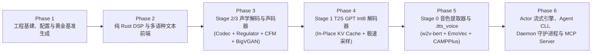

# IndexTTS-2.5 Rust 高性能推理引擎与 Agent CLI 分步实施计划 (`indextts-rust-impl-plan`)

## 1. 实施总则与开发铁律

本实施计划将 [`indextts-rust-prd`](./indextts-rust-prd.md) 与 [`indextts-rust-engine-design`](./indextts-rust-engine-design.md) 拆解为 **6 个可独立交付、逐步叠加验证的阶段（Phases）**。

在执行每个阶段时，必须严格遵守 [AGENTS.md](../AGENTS.md) 规范：
1. **零半成品与零 TODO**：绝不提交包含 `todo!()`、`unimplemented!()`、死代码或临时桩代码的模块；每个阶段结束时必须是一个编译通过、测试全绿、文档齐全的完整闭环。
2. **安全与 Lint 门禁**：
   - 每个 Crate 根节点强制声明 `#![forbid(unsafe_code)]` 与 `#![warn(rust_2024_compatibility, missing_docs, missing_debug_implementations)]`。
   - 任何生产路径严禁出现 `unwrap()`、`expect()`、`panic!()` 或未检查的切片索引 `[]`；统一使用 `thiserror`（`crates/core`）与 `anyhow`（`apps/*`）。
3. **自动化统一收敛于 `Makefile`**：不编写零散的 `.sh` 脚本，所有黄金基准生成、单测、集成验证、Clippy 检查与 Benchmark 统一作为 `Makefile` Target 维护。

---

## 2. 阶段推进路线图 (Phase Roadmap)

> **为什么先实现 Phase 3（S2M + BigVGAN），再实现 Phase 4（GPT）和 Phase 5（Stage 0）？**
> - **由简入繁、快速听音验证**：利用 Phase 1 从本机 Python 导出的 `SpeakerContext`（1.5MB）和 `codes`（几十个整数），在 Phase 3 结束时就能直接合成出第一段 `22050 Hz` WAV 语音并与原版波形对比；
> - **先打通常驻的 1.68 GB 合成主干**：Phase 3 + Phase 4 完成后，整个 `SynthesisEngine`（读取 `.itts_voice` 直接合成语音）就已经 100% 可用！Phase 5 再补齐从原始 `.wav` 生成 `.itts_voice` 的 `VoiceExtractor`。

---

## 3. 各阶段详细任务拆解

### Phase 1：Workspace 基建、领域类型、权重加载器与黄金测试基准

#### 3.1.1 目标
完成 Workspace 依赖升级、工具链固定、基础领域类型与错误体系、SafeTensors 死权重过滤加载器，并利用本机已安装的 Python `index-tts-2.5-mlx` 生成用于全链路数值对齐测试的 Golden Fixtures。

#### 3.1.2 涉及文件与变更清单
1. **`rust-toolchain.toml`（新建）**：固定最新稳定版 Rust 工具链（`channel = "stable"`, `components = ["rustfmt", "clippy"]`）。
2. **`Cargo.toml`（更新）**：
   - 在 `[workspace.dependencies]` 中引入：
     - `mlx-rs = { version = "0.33.0", features = ["metal", "safetensors"] }`
     - `safetensors = "0.8.0"`、`memmap2 = "0.9"`
     - `winnow = "1.0.4"`、`base64 = "0.22"`、`regex = "1"`
     - `symphonia = { version = "0.6.1", features = ["wav", "mp3", "flac", "pcm", "isomp4"] }`、`hound = "3.5.1"`
     - `realfft = "3.5.1"`、`rustfft = "6.4.1"`
     - `flume = "0.12.0"`、`dashmap = "6.1"`、`arc-swap = "1.9.3"`
     - `typed-builder = "0.23.2"`、`validator = { version = "0.21.0", features = ["derive"] }`
     - `config = { version = "0.15.27", default-features = false, features = ["yaml"] }`
     - `tracing = "0.1"`、`tracing-subscriber = { version = "0.3", features = ["env-filter", "json"] }`
     - `clap = { version = "4.6.7", features = ["derive", "env"] }`、`cpal = "0.18.2"`、`hf-hub = "1.0.0"`、`rmcp = { version = "3.8.0", features = ["server", "transport-io"] }`
     - 测试依赖：`rstest = "0.26"`、`proptest = "1.6"`、`approx = "0.5"`
3. **`Makefile`（更新）**：
   - 新增 `generate-fixtures` Target：调用本机 Python 环境生成最小黄金对齐张量文件 `crates/core/fixtures/golden_ref.safetensors` 与 `crates/core/fixtures/golden_speaker.itts_voice`。
   - 新增 `lint`、`fmt`、`audit` Target。
4. **`crates/core/src/error.rs`（新建）**：
   - 定义 `IndexTtsError`（涵盖 `Config`, `Validation`, `Io`, `AudioDecode`, `Tokenize`, `WeightLoad`, `Mlx`, `VoiceNotFound`, `ChannelClosed`, `Cancelled`）。
5. **`crates/core/src/config.rs`（新建）**：
   - 定义 Newtypes（`SynthesisText`, `VoiceId`, `Temperature`, `TopP`, `TopK`, `RepetitionPenalty`, `DurationFactor`, `CfgRate`）及 YAML 配置加载器 `EngineConfig`。
6. **`crates/core/src/models/loader.rs`（新建）**：
   - 实现 Hugging Face 本地快照自动定位（支持自动解析 `~/.cache/huggingface/hub/models--yunfengwang--IndexTTS-2.5-mlx/snapshots/<rev>` 或显式 `--model-dir`）；
   - 实现 `spk_proj.npz` 纯 Rust 解析器（读取 `[1280, 192]` weight 与 `[1280]` bias）；
   - 实现带前缀黑名单过滤与 Conv 维度自动转置的 SafeTensors 权重加载器。
7. **`crates/core/src/voice/context.rs`（新建）**：
   - 实现 `SpeakerContext` 与 `.itts_voice`（SafeTensors 格式）的读写与元数据校验。

#### 3.1.3 阶段准出标准 (Exit Criteria)
- `cargo test -p index-tts-rs-core` 通过：成功解析本机模型目录、读取 `spk_proj.npz`、读写 `.itts_voice`，且验证死权重过滤逻辑准确剔除 `semantic_model` 第 17..23 层与 `semantic_codec` 编码端权重。

---

### Phase 2：纯 Rust 数字信号处理 (DSP) 与多语种文本前端

#### 3.2.1 目标
在完全不依赖任何 Python 库（无 `librosa`、`torchaudio`、`kaldi-native-fbank`、`transformers`、`tiktoken`、`wetext`）的前提下，用纯 Rust 实现音频重采样、三种频谱特征提取、多语种注音语法解析与 Tiktoken BPE 分词，并与 Golden Fixtures 达到数值对齐。

#### 3.2.2 涉及文件与变更清单
1. **`crates/core/src/dsp/audio.rs`（新建）**：
   - 使用 `symphonia` 解码音频为单声道 `f32`，使用 `hound` 将 `i16` PCM 写入 `22050 Hz` WAV。
2. **`crates/core/src/dsp/resample.rs`（新建）**：
   - 实现 `resample_sinc_hann(y, orig_freq, new_freq, 6, 0.99)`（f64 核 + f32 步进矩阵乘，与 `core/dsp.py` 逐样本对齐）。
3. **`crates/core/src/dsp/mel.rs`（新建）**：
   - 实现 Slaney 归一化 Mel 滤波器组生成（80 bins, 1024 FFT, 22050 Hz）与 `mel_spectrogram`（reflect pad 384, periodic Hann 窗, `realfft` 1024-pt RFFT, $\ln(\max(x, 10^{-5}))$）。
4. **`crates/core/src/dsp/fbank.rs`（新建）**：
   - 实现 Kaldi 兼容 Povey 窗（25ms/400点, 10ms/160点帧移, DC 偏置移除, 0.97 预加重, 512-pt RFFT, Kaldi Mel 刻度 $1127\ln(1+f/700)$）；
   - 实现 `campplus_fbank(audio_16k) -> [1, T, 80]`（Utterance Mean Normalization）；
   - 实现 `w2v_features(audio_16k) -> ([1, T//2, 160], [1, T//2])`（$\times 32768.0$ + 每通道 `ddof=1` 方差归一化 + `stride=2` 拼接）。
5. **`crates/core/src/frontend/parser.rs`（新建）**：
   - 使用 `winnow` 实现 `<word|PRON>` 注音标注语法解析器（区分假名、汉字 `<|SPECIAL_TOKEN_2|>`、拉丁字母 `<|SPECIAL_TOKEN_1|>`）与 `<|SPECIAL_TOKEN_\d+|>` 保护块切分器。
6. **`crates/core/src/frontend/normalizer.rs`（新建）**：
   - 实现 `CHAR_REP_MAP` / `ZH_CHAR_REP_MAP` 标点清理、`glossary.yaml` 词典替换、技术术语/人名/拼音声调（`jqx` + `u/ü` -> `v`）保护与还原、以及纯 Rust 中英文常见数字/百分比/小数转写。
7. **`crates/core/src/frontend/tokenizer.rs` & `splitter.rs`（新建）**：
   - 解析 `multilingual_zh_ja_yue_char_del.tiktoken`（58,836 基础词 + 1,673 特殊 Token），实现字节级 BPE 编码与基于 `max_text_tokens_per_segment = 120` 的标点分句器（自动过滤 `token_id <= 1`）。

#### 3.2.3 阶段准出标准 (Exit Criteria)
- `Tokenizer` 对中、英、日、粤及带 `<行|HANG2>` 注音文本的编码结果与 Python `tiktoken` **100% Bit-Exact 一致**。
- `resample_sinc_hann`、`mel_spectrogram`、`campplus_fbank`、`w2v_features` 输出与 Golden Fixtures 的余弦相似度 $\ge 0.9999$，最大绝对误差 $< 10^{-4}$。

---

### Phase 3：Stage 2 & Stage 3 声学解码与声码器 (`mlx-rs`)

#### 3.3.1 目标
基于 `mlx-rs` 实现 `SemanticCodec`、`LengthRegulator`、`CfmDit`（含全 GPU 驻留 Euler 求解器）与 `BigVgan`，打通从 `codes` + `SpeakerContext` 到 `22050 Hz` WAV 语音的合成后半程。

#### 3.3.2 涉及文件与变更清单
1. **`crates/core/src/models/codec.rs`（新建）**：
   - 实现 `SemanticCodec`（`FactorizedVectorQuantize` `8192x8` -> `out_project Conv1d(8->1024, k=1)` -> `VocosBackbone` 12 层 `ConvNeXtBlock` -> `Linear(384->1024)` -> `repeat(2)` -> `up Conv1d(1024->1024, k=3)`）。
   - 加载 `raw/semantic_codec.safetensors` 时自动剔除 101MB 编码器死权重。
2. **`crates/core/src/models/regulator.rs`（新建）**：
   - 实现 `LengthRegulator`（`content_in_proj Linear(1024->512)` + `nearest_expand_indices` + 4 层 `Conv1d(k=3) + GroupNorm(1, pytorch_compatible=True) + Mish` + `Conv1d(k=1)`）。
3. **`crates/core/src/models/cfm.rs`（新建）**：
   - 实现 `Dit`（`TimestepEmbedder` x2、`cond_projection`、`cond_x_merge_linear`、13 层 `Transformer` 含 `AdaLN` + `RoPE` + U-ViT 长跳跃连接 `0..5 -> 7..12`、8 层 `WN` WaveNet、`FinalLayer`、`conv2`）。
   - 实现**全 GPU 驻留 `solve_euler`**：循环外预计算 `cond_projection(cat_condition)` 与 Batch=2 CFG 静态条件张量，25 步迭代完全在 GPU `mlx_rs::Array` 内推进。
4. **`crates/core/src/models/bigvgan.rs`（新建）**：
   - 实现 `BigVgan`（`conv_pre` -> 6 级相位分解 `ConvTranspose1d` `[4,4,2,2,2,2]` + 18 个 `AMPBlock1` 含 2x Kaiser-Sinc 抗混叠重采样 `SnakeBeta` + 16 倍数通道补齐 `_conv1d_f32` -> `activation_post` -> `conv_post` -> `clip(-1, 1)`）。

#### 3.3.3 阶段准出标准 (Exit Criteria)
- 输入 Golden Fixture 中的 `codes`、固定高斯噪声 `z` 和 `SpeakerContext`，Rust 产出的 `s_infer`、`cat_condition`、`mel` 和 `wav` 与 Python 参考输出余弦相似度 $\ge 0.9995$，生成的 `.wav` 文件可正常播放且音质纯净。

---

### Phase 4：Stage 1 自回归 GPT Int8 解码器与极速采样器 (`mlx-rs`)

#### 3.4.1 目标
实现 `gpt_int8.safetensors` 的加载、预分配 In-Place KV Cache 的自回归推理，以及 $O(V)$ 复杂度的 Rust 采样器，打通「输入任意文本 + `.itts_voice` -> 输出完整语音」的端到端合成闭环。

#### 3.4.2 涉及文件与变更清单
1. **`crates/core/src/models/gpt.rs`（新建）**：
   - 实现 `Gpt`：词表与位置嵌入层（`text_embedding [60510, 1280]`、`lang_embedding [107, 1280]`、`mel_embedding [8194, 1280]`、`mel_pos_embedding [1818, 1280]`、`text_pos_embedding [602, 1280]`）+ 24 层 `Block`（`QuantizedLinear` `group_size=64, bits=8`，`gelu_approx`）+ `final_norm` + `mel_head`。
   - 实现 `KvCache`：预分配 24 层 `[1, 20, max_seq, 64]` K/V 张量，支持 `prefill` 初始化与 `step` 原地切片更新（`pos_idx = step_idx + 2`）。
2. **`crates/core/src/models/sampler.rs`（新建）**：
   - 实现栈上 `SeenTokenBitSet`（`[u64; 129]`，覆盖 8194 个 Mel Token，初始置位 `1` 和 `8192`）；
   - 实现 `RepetitionPenalty` -> `Temperature` -> 基于 `select_nth_unstable_by` 的 $O(V)$ `TopK` -> `TopP` 核采样（及 `greedy` argmax 模式）。

#### 3.4.3 阶段准出标准 (Exit Criteria)
- `prefill` 首步 8,194 维 Logits 与 Python 参考输出的余弦相似度 $\ge 0.9999$；
- `greedy = true` 模式下生成的 `codes` 序列与 Python 参考实现一致；
- 单进程加载 `.itts_voice` 完成端到端文本转语音合成，常驻内存 $\le 1.75\text{ GB}$。

---

### Phase 5：Stage 0 音色提取引擎 (`VoiceExtractor`) 与音色库管理

#### 3.5.1 目标
实现 `SemanticModel`（`w2v-bert-2.0` 前 17 层）、`EmoVec`（Conformer + PerceiverResampler）与 `CampPlus`，支持从任意原始参考音频 `.wav`/`.mp3` 实时提取 `SpeakerContext` 并保存为 `.itts_voice`。

#### 3.5.2 涉及文件与变更清单
1. **`crates/core/src/models/semantic.rs`（新建）**：
   - 实现 `SemanticModel`：`FeatureProjection(160->1024)` + 17 层 Conformer `EncoderLayer`（含 `relative_key` `distance_embedding [73, 64]`、因果 Depthwise Conv `k=31`、Macaron FFN x0.5）+ `(h - _mean) / _std`。
   - 加载时严格跳过第 17..23 层（省 677.1 MB）。
2. **`crates/core/src/models/emo.rs`（新建）**：
   - 实现 `EmoVec`：`Conv2dSubsampling2` + 4 层 `ConformerEncoderLayer`（含 `pos_bias_u/v` 相对位置注意力）+ 2 层 `PerceiverResampler`（`GEGLU` + `PercRMSNorm`）+ `emovec_layer` + `emo_layer`。
3. **`crates/core/src/models/campplus.rs`（新建）**：
   - 实现 `CampPlus`：`FCM`（2D ResBlock 特征提取）+ `XVector`（`TDNNLayer` + 3 个 `CAMDenseTDNNBlock` `[12, 24, 16]` 含 `_seg_pool` 100 帧分段池化 + `TransitLayer` + `StatsPool(ddof=1)` + `DenseLayer`），强制 `eval()` 模式。
4. **`crates/core/src/voice/store.rs`（新建）**：
   - 实现 `VoiceStore`：基于 `DashMap<VoiceId, Arc<SpeakerContext>>` 的内存缓存 + `~/.cache/index-tts-rs/voices/<voice_id>.itts_voice` 磁盘持久化，支持独立情感音频与 `emo_alpha` 混合。

#### 3.5.3 阶段准出标准 (Exit Criteria)
- 输入 Golden 参考音频，Rust `VoiceExtractor` 提取出的 `spk_cond_emb`、`emovec`、`style`、`conds`、`prompt_condition` 与 Python `build_speaker` 的余弦相似度 $\ge 0.9995$。
- 支持在提取完成后调用 `evict_voice_extractor()` 立即释放 2.3GB 编码器内存。

---

### Phase 6：Actor 流式管线、Agent CLI (`apps/cli`)、Daemon 与 MCP Server

#### 3.6.1 目标
封装线程安全的 `IndexTtsEngine` Actor 流式 API，构建 `apps/cli` (`index-tts`) 命令行工具、CoreAudio 实时播放器、Unix Domain Socket 常驻守护进程、MCP Server 以及 `apps/server` HTTP 接口。

#### 3.6.2 涉及文件与变更清单
1. **`crates/core/src/engine/actor.rs` & `stream.rs` & `crates/core/src/lib.rs`（新建/更新）**：
   - 实现 `MlxWorkerActor`（专属 OS 线程 + `flume::bounded` 命令通道 + `AtomicBool` 优雅停机）与 `SynthesisStream`（逐句流式产出 `AudioChunk`）。
   - 完善 `crates/core/src/lib.rs` 的公开 API 文档与 Doctests。
2. **`apps/cli/Cargo.toml` & `apps/cli/src/main.rs`（新建）**：
   - 创建二进制包 `index-tts`，实现 `synth`、`voice` (`add`/`list`/`inspect`/`rm`)、`models` (`pull`/`info`)、`daemon` (`start`/`stop`/`status`)、`mcp` 五大子命令。
3. **`apps/cli/src/player.rs`（新建）**：
   - 基于 `cpal` 实现 macOS CoreAudio 实时流式播放队列（支持硬件采样率自动适配与无爆音缓冲）。
4. **`apps/cli/src/daemon.rs`（新建）**：
   - 实现 `~/.cache/index-tts-rs/daemon.sock` 服务端与客户端自动检测转发逻辑，支持空闲超时自动退出。
5. **`apps/cli/src/mcp.rs`（新建）**：
   - 基于 `rmcp` 实现 stdio MCP Server，暴露 `speak`、`synthesize_to_file`、`register_voice`、`list_voices`。
6. **`apps/server/src/main.rs`（更新）**：
   - 提供轻量级 HTTP 健康检查与 `/v1/audio/speech` 合成端点。

#### 3.6.3 阶段准出标准 (Exit Criteria)
- 全量质量门禁通过：`cargo build --release`、`cargo nextest run --all-features`、`cargo +nightly fmt --check`、`cargo clippy --all-targets -- -D warnings -W clippy::pedantic`。
- Agent CLI 实测验证：`index-tts voice add`、`index-tts synth --play --json`、Daemon 热态毫秒级响应、以及 MCP stdio 协议交互全部通过。
