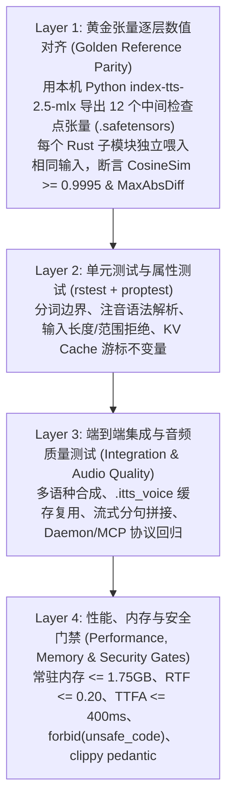

# IndexTTS-2.5 Rust 高性能推理引擎与 Agent CLI 验证计划 (`indextts-rust-verification-plan`)

## 1. 验证目标与总体策略

语音合成与深度学习推理引擎的重构最忌讳“整体黑盒联调”——如果端到端出来的声音是噪音或乱码，很难定位是重采样、Kaldi Fbank、Tokenizer、注意力掩码还是声码器相位出了偏差。

因此，本验证计划确立 **「黄金基准隔离验证（Golden Fixture Isolation）+ 逐层数值门禁 + 属性安全测试 + 端到端性能剖析」** 的四层验证体系：



---

## 2. Layer 1：黄金测试基准（Golden Fixtures）生成与逐算子容差标准

### 2.1 黄金基准生成协议 (`make generate-fixtures`)

利用本机已有的 `/Users/tchen/.cache/uv/archive-v0/PihKeqevoTnFDUja/bin/python` 与本机 HF 缓存权重，通过 `Makefile` 中的 `generate-fixtures` 目标一次性生成两个确定性基准文件存放于 `crates/core/fixtures/`：

1. **`crates/core/fixtures/golden_ref.safetensors`**：
   - 使用确定性合成的 2.0 秒测试参考语音波形（含基频与谐波包络，采样率 24000 Hz，以同时测试 `24000 -> 22050` 与 `22050 -> 16000` 重采样）及固定随机种子 `seed = 42`、固定高斯噪声 `z`（`[1, 80, T]`），保存全管线 14 个关键检查点张量。
2. **`crates/core/fixtures/golden_speaker.itts_voice`**：
   - 包含 `conds`、`prompt_condition`、`ref_mel`、`style` 四个张量的标准 `.itts_voice` 文件。

### 2.2 14 个检查点张量与精确数值验收阈值

所有数值对比测试统一计算三个指标：
- **余弦相似度（Cosine Similarity）**：$\text{cos\_sim}(A, B) = \frac{\sum A_i B_i}{\sqrt{\sum A_i^2}\sqrt{\sum B_i^2}}$
- **最大绝对误差（Max Absolute Error）**：$\max_i |A_i - B_i|$
- **相对均方根误差（Relative RMSE）**：$\frac{\|A - B\|_2}{\|A\|_2}$

| 检查点编号 | 模块路径 | 输入张量 (来自 Fixture) | 输出张量键名与形状 | 余弦相似度下限 | 最大绝对误差上限 / 精确度要求 |
| :--- | :--- | :--- | :--- | :--- | :--- |
| **CP-01** | `dsp::resample` | `raw_audio_24k [48000]` | `audio_22k [44100]`, `audio_16k [32000]` | $\ge 0.99999$ | $\text{MaxAbs} < 5 \times 10^{-5}$ |
| **CP-02** | `dsp::mel` | `audio_22k [44100]` | `ref_mel [1, 80, 173]` | $\ge 0.99999$ | $\text{MaxAbs} < 1 \times 10^{-4}$ |
| **CP-03** | `dsp::fbank` | `audio_16k [32000]` | `campplus_fbank [1, 198, 80]` | $\ge 0.99995$ | $\text{MaxAbs} < 5 \times 10^{-4}$ |
| **CP-04** | `dsp::fbank` | `audio_16k [32000]` | `w2v_input_features [1, 99, 160]`<br>`w2v_attention_mask [1, 99]` | $\ge 0.99995$ | Mask **100% Bit-Exact**；Features $\text{MaxAbs} < 5 \times 10^{-4}$ |
| **CP-05** | `frontend::tokenizer` | 多语种与注音测试集 (6 条文本) | `token_ids_0..5` | **1.00000** | **100% 整数序列完全相等 (Bit-Exact)** |
| **CP-06** | `models::semantic` | `w2v_input_features`, `w2v_attention_mask` | `spk_cond_emb [1, 99, 1024]` | $\ge 0.9999$ | $\text{RelRMSE} < 1.5 \times 10^{-3}$ ($\text{MaxAbs} < 3 \times 10^{-2}$) |
| **CP-07** | `models::emo` | `spk_cond_emb`, `ilens=[99]` | `emovec [1, 1280]` | $\ge 0.9999$ | $\text{MaxAbs} < 1 \times 10^{-3}$ |
| **CP-08** | `models::campplus` | `campplus_fbank` | `style [1, 192]` & `conds [1, 3, 1280]` | $\ge 0.9999$ | $\text{MaxAbs} < 1 \times 10^{-3}$ |
| **CP-09** | `models::regulator` | `spk_cond_emb`, `target_len=173` | `prompt_condition [1, 173, 512]` | $\ge 0.9999$ | $\text{MaxAbs} < 1 \times 10^{-3}$ |
| **CP-10** | `models::gpt` (Prefill) | `text_ids`, `conds`, `lang_id=1` | `prefill_logits [8194]` | $\ge 0.9999$ | Top-10 候选 Token ID **100% 一致** |
| **CP-11** | `models::gpt` (Greedy) | `text_ids`, `conds`, `lang_id=1` | `greedy_codes [T_code]` | — | 前 32 步 Greedy Token **100% 完全一致** |
| **CP-12** | `models::codec` | `greedy_codes [1, T_code]` | `s_infer [1, 2*T_code, 1024]` & `cat_condition [1, T_cat, 512]` | $\ge 0.9999$ | `s_infer` $\text{RelRMSE} < 1 \times 10^{-3}$ ($\text{MaxAbs} < 5 \times 10^{-3}$); `cat_condition` $\text{MaxAbs} < 1 \times 10^{-3}$ |
| **CP-13** | `models::cfm` | `cat_condition`, `ref_mel`, `style`, 固定噪声 `z` | `generated_mel [1, 80, T_gen]` | $\ge 0.9995$ | 25 步 ODE 累积误差 $\text{RelRMSE} < 3 \times 10^{-3}$ |
| **CP-14** | `models::bigvgan` | `generated_mel [1, 80, T_gen]` | `wav_f32 [256 * T_gen]` | $\ge 0.9995$ | $\text{MaxAbs} < 2 \times 10^{-3}$，信噪比 $\text{SNR} > 50\text{ dB}$ |

---

## 3. Layer 2：单元测试与属性测试矩阵 (`rstest` & `proptest`)

所有测试函数命名遵循 `test_should_<expected_behavior>_when_<condition>` 规范：

### 3.1 参数化单元测试 (`rstest`)
1. **多音字与多语种注音解析 (`frontend::parser`)**：
   - `test_should_wrap_chinese_pinyin_with_special_token_2`: `<行|hang2>业` $\rightarrow$ `<|SPECIAL_TOKEN_2|>HANG2<|SPECIAL_TOKEN_2|>业`
   - `test_should_wrap_english_phoneme_with_special_token_1`: `<read|R EH1 D>` $\rightarrow$ `<|SPECIAL_TOKEN_1|>R EH1 D<|SPECIAL_TOKEN_1|>`
   - `test_should_inline_japanese_kana_with_spaces`: `<明日|あした>` $\rightarrow$ ` あした `
   - `test_should_normalize_jqx_umlaut_to_v`: `ju1`, `qu2`, `xu3`, `jü4` $\rightarrow$ `JV1`, `QV2`, `XV3`, `JV4`
2. **分句器与特殊 Token 保护 (`frontend::splitter`)**：
   - `test_should_never_split_inside_special_token_span`: 验证当 `<|SPECIAL_TOKEN_2|>...<|SPECIAL_TOKEN_2|>` 跨在预算边界上时，永远作为不可分割的原子块整体保留。
   - `test_should_strip_literal_zero_and_one_tokens`: 验证英文 `"surprise!"` 等可能产生 `token_id = 0` 的输入在 `prepare` 输出中被干净剥离。
3. **权重过滤与转置 (`models::loader`)**：
   - `test_should_skip_unused_w2v_layers_17_to_23`: 验证加载 `semantic_model.safetensors` 时只返回前 17 层参数。
   - `test_should_skip_codec_encoder_and_down_layers`: 验证加载 `semantic_codec.safetensors` 时剔除所有 `encoder.*` 与 `down.*`。
4. **错误边界与非法输入拒绝 (`config` & `error`)**：
   - `test_should_reject_empty_or_oversized_text`
   - `test_should_reject_voice_id_with_path_traversal`（如 `"../etc/passwd"`, `"foo/bar"`, `"a\0b"`）
   - `test_should_reject_out_of_range_sampling_params`（如 `temperature = 0.0`, `top_p = 1.5`, `n_timesteps = 0`）

### 3.2 属性测试 (`proptest`)
1. **`proptest_text_frontend_never_panics_on_arbitrary_utf8`**：
   - 生成任意 UTF-8 字符串（包含 Emoji、不闭合的 `<` / `|` / `>`、连续标点、控制字符、超长无标点字符串），验证 `Frontend::prepare` **绝不 Panic**，且产出的每个分句长度均 $\le \text{text\_pos\_capacity} - 2$。
2. **`proptest_sampler_always_returns_valid_mel_token_id`**：
   - 生成任意包含极端大值/小值（不含 NaN）的 8194 维 Logits 分布与任意合法 `(temperature, top_k, top_p, repetition_penalty)` 组合，验证采样器返回值严格落在 `0..8194` 范围内且绝不越界。
3. **`proptest_nearest_expand_indices_monotonic_and_in_bounds`**：
   - 对任意 `t_in in 1..2000` 与 `t_out in 1..4000`，验证 `nearest_expand_indices` 产出的索引单调非递减且全部 $< t_{\text{in}}$。

---

## 4. Layer 3：集成测试与 Agent 工作流验证 (`tests/`)

由于加载真实 1.68 GB / 3.9 GB 模型权重的测试耗时较长（数秒），遵循 [AGENTS.md](../AGENTS.md) 规范：
- **快速单测（默认 `cargo test`）**：使用小型合成张量或 Golden Fixtures 切片，在 **< 2 秒**内完成全部逻辑与算子回归。
- **真实权重全链路测试（标记 `#[ignore]`，通过 `cargo test -- --ignored` 或 `make test-e2e` 运行）**：
  1. `test_should_extract_speaker_and_roundtrip_itts_voice_file`：从真实 `.wav` 提取 `SpeakerContext`，保存为 `.itts_voice`，重新加载后断言张量 100% 相等。
  2. `test_should_synthesize_speech_from_cached_voice_without_loading_encoders`：仅加载 Stage 1~3 合成引擎，从 `.itts_voice` 合成中文、英文、中英混合语音，验证输出音频有效时长、非全零、无削波失真（Clipping）。
  3. `test_should_stream_audio_chunks_and_support_early_cancellation`：输入包含 4 个句子的文本，通过 `synthesize_stream` 读取第 1 个 `AudioChunk` 后立即 `drop(stream)`，验证后台 Actor 立即中止剩余 3 个句子的推理。
  4. `test_should_auto_forward_cli_synth_to_running_daemon`：启动临时 Unix Socket Daemon，连续执行两次 CLI 合成请求，验证第二次请求的模型加载耗时为 `0.0 ms`。
  5. `test_should_handle_mcp_tools_over_stdio`：向 `index-tts mcp` 发送 `tools/list` 与 `tools/call (list_voices / synthesize_to_file)` JSON-RPC 请求，验证返回符合 MCP 规范的 JSON 响应。

---

## 5. Layer 4：性能基准 (`criterion`) 与代码质量门禁

### 5.1 静态分析与安全门禁 (`make lint`)
每次代码变更必须通过以下全套检查：
```bash
cargo build --workspace --all-targets
cargo test --workspace
cargo +nightly fmt --all -- --check
cargo clippy --workspace --all-targets -- -D warnings -W clippy::pedantic \
    -W clippy::unwrap_used -W clippy::expect_used -W clippy::indexing_slicing -W clippy::panic
```

### 5.2 性能与内存验收剖析 (`make bench`)
在 Phase 6 完成后，使用 `criterion` 与 macOS `/usr/bin/time -l`（测量 Peak Resident Set Size / Metal Footprint）对比原版 Python `index-tts-2.5-mlx` 与 Rust `index-tts`：

1. **微基准测试 (`benches/`)**：
   - `bench_dsp_mel_and_fbank`: 15 秒音频的 DSP 特征提取耗时（目标 **< 5 ms**）。
   - `bench_gpt_sampler_step`: 单步 8194 维 Logits RepetitionPenalty + TopK + TopP 采样耗时（目标 **< 10 µs**）。
   - `bench_tokenizer_prepare`: 500 字中英混合文本正则化 + 分词耗时（目标 **< 500 µs**）。
2. **端到端系统级对比验收表**：
   - 测量标准测试句（中英混合，生成约 5 秒语音）在你的 MBP 上的表现：
     - 确认常驻内存峰值 **$\le 1.75\text{ GB}$**；
     - 确认端到端 RTF **$\le 0.20$**；
     - 确认流式首包延迟（TTFA）**$\le 400\text{ ms}$**。
